# NewAgent

Ground-up, asynchronous AI coding assistant, autonomous task execution engine, and multi-interface orchestration platform featuring dual REST and Gemini Interactions API drivers, dynamic OpenRouter catalog discovery, subagent delegation, zero-leakage in-memory key resolution, BEJSON/MFDB local-first persistence, 57-column positional terminal user interfaces, and an offline web tooling suite.

[]()
[]()
[]()
[]()
[]()
[]()
[](LICENSE)

---

## Author & Credits

- **Author & Core Architect**: Elton Boehnen
- **Email**: [boehnenelton2024@gmail.com](mailto:boehnenelton2024@gmail.com)
- **Website**: [boehnenelton2024.pages.dev](https://boehnenelton2024.pages.dev)
- **GitHub**: [github.com/boehnenelton](https://github.com/boehnenelton)
- **Format Creator & Maintainer**: Elton Boehnen
- **Document Fingerprint / RELATIONAL_ID**: `2df20dff-a417-420d-ab06-af92e5418250`
- **Release Package**: `v1.2.15` / `PKG 135`

---

## Table of Contents

- [Phase 1: Setup, Quickstart & Visual Tour](#phase-1-setup-quickstart--visual-tour)
  - [Prerequisites & Environment Setup](#prerequisites--environment-setup)
  - [Installation & Quick Start](#installation--quick-start)
  - [Core Workflows & Interface Surfaces](#core-workflows--interface-surfaces)
  - [Visual Interface Tour](#visual-interface-tour)
- [Phase 2: Technical Architecture & System Specifications](#phase-2-technical-architecture--system-specifications)
  - [System Architecture & Pipeline Topology](#system-architecture--pipeline-topology)
  - [Dual AI Execution Engines & Provider Routing](#dual-ai-execution-engines--provider-routing)
  - [Context Bubble Engine & Tree-Walking Persistent Directives](#context-bubble-engine--tree-walking-persistent-directives)
  - [Antigravity (agy) Skills Compatibility Layer](#antigravity-agy-skills-compatibility-layer)
  - [57-Column BEJSON Positional Telemetry Configuration Manager](#57-column-bejson-positional-telemetry-configuration-manager)
  - [Unified Tooling Architecture & Library Synchronization](#unified-tooling-architecture--library-synchronization)
  - [BEJSON & MFDB Persistence Standards](#bejson--mfdb-persistence-standards)
  - [CLI Flag & Command Matrix](#cli-flag--command-matrix)
  - [Testing, Verification & Playwright Automated Suites](#testing-verification--playwright-automated-suites)

---

# Phase 1: Setup, Quickstart & Visual Tour

## Prerequisites & Environment Setup

NewAgent requires **Python 3.10 or higher** and runs natively on Linux, macOS, and Android (Termux) without container overhead.

### 1. Dependencies
```bash
pip install flask pillow termux-playwright
```

### 2. Environment Variables & Credential Stores
NewAgent implements a zero-leakage security model where credentials reside in local JSON environment stores referenced via environment variables, keeping sensitive keys out of git commits and shell histories.

Define the following environment variables in your shell profile (`~/.bashrc`, `~/.zshrc`, or environment loader):

```bash
# Path to your secure credentials store (API keys)
export SECURE_ENV_PATH="/path/to/your/secureenv_file.json"

# Path to your non-sensitive system definitions and paths
export DEFINITIONS_PATH="/path/to/your/definitions.json"

# Optional: Default CMS admin credentials for bundled web tools
export CMS_USER="admin"
export CMS_PASSWORD="your-strong-password"
```

---

## Installation & Quick Start

Clone the repository and inspect the root entry points:

```bash
git clone https://github.com/boehnenelton/NewAgent.git
cd NewAgent
```

### Launching the Interactive Terminal Agent
To start an interactive coding session with ANSI telemetry and auto-execution guardrails:
```bash
python3 agent.py
```

### Running Non-Interactive Scripted Commands
To run one-shot prompts or automated terminal scripts:
```bash
python3 cliagent.py --prompt "Audit the current workspace for dead functions" --execute
```

### Managing System Settings via the 57-Column TUI
To launch the dedicated 57-column terminal configuration manager:
```bash
python3 config_manager.py
```

### Starting the Web Terminal Portal
To launch the browser-based terminal GUI on loopback:
```bash
python3 webagent.py --port 5001
```

---

## Core Workflows & Interface Surfaces

NewAgent provides five coordinated operational surfaces:

1. **`agent.py` (Interactive Terminal Agent)**: Multi-turn conversant with live context bubble assembly, action tag execution (`<exec>`, `<edit_file>`, `<create_file>`), auto-continue loops, and data-driven slash commands.
2. **`cliagent.py` (Headless Scriptable Daemon)**: Zero-overhead CLI designed for pipelines, shell pipes, and background cron scripts with structured JSON output and timeout enforcement.
3. **`config_manager.py` (57-Column Positional Configuration Manager)**: High-density terminal dashboard organizing all 67 system settings across 7 domain categories (`ENG`, `AUT`, `MEM`, `EXT`, `SYS`, `BUB`, `CLI`) with one-key toggles, numbered presets, and Termux picker integration.
4. **`webagent.py` (Web Terminal & Settings Portal)**: Browser-based terminal serving an interactive command shell, job runner, auto-saving notes panel, and configuration controls authenticated via URL-safe tokens.
5. **`JobMaker.py` (Offline Job Creation System)**: Dedicated web interface to define autonomous task cards, verify goal criteria, and stage BEJSON 104a job manifests.

---

## Visual Interface Tour

The following interface views illustrate NewAgent's operational surfaces, captured directly via automated Playwright test runs and scaled to the 420px responsive standard.

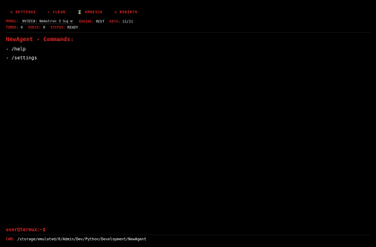
*_Figure 1: WebAgent Terminal & Chat Console (`webagent.py`)_*

The WebAgent terminal provides authenticated browser access to NewAgent's execution engine, featuring live token/engine telemetry, command history, and direct shell execution escapes.

---

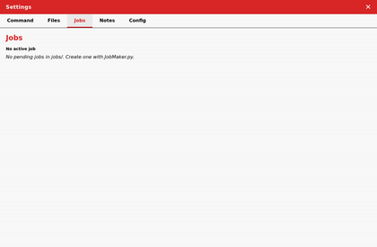
*_Figure 2: WebAgent Jobs Management Interface_*

The Jobs tab lists pending and active BEJSON task cards, allowing operators to trigger multi-task agent jobs and monitor execution progress in real time.

---

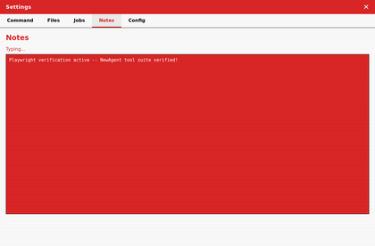
*_Figure 3: WebAgent Auto-Saving Persistent Notes Tab_*

The Notes tab provides a scratchpad for cross-session developer notes that automatically saves to disk without manual intervention.

---

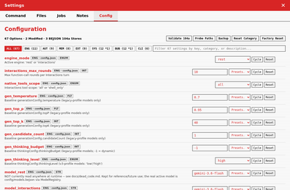
*_Figure 4: WebAgent Live Configuration Tab_*

The Configuration panel allows real-time inspection and adjustment of model parameters, execution gates, and compatibility flags.

---

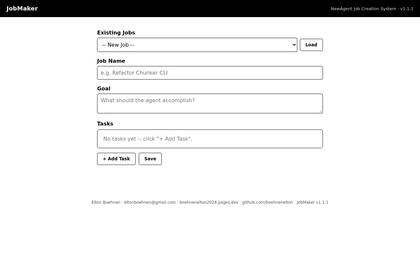
*_Figure 5: JobMaker Task Workflow Dashboard (`JobMaker.py`)_*

JobMaker provides a clean interface to author, name, and stage multi-task autonomous job manifests with goal specifications.

---

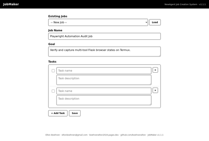
*_Figure 6: JobMaker Populated Task List with Audit Flags_*

Task cards can be ordered, flagged for automated post-task quality audits, and persisted directly to the jobs directory as BEJSON 104a schemas.

---

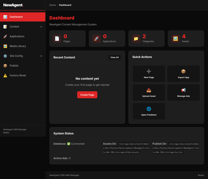
*_Figure 7: NewAgent CMS Admin Hub Dashboard (`tools/NA-CMS/`)*_

The bundled NewAgent CMS tool features a modular multi-cube architecture governing site records, database manifests, and storage integrity.

---

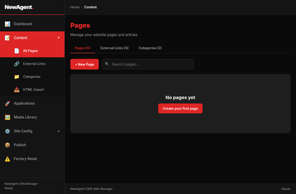
*_Figure 8: NewAgent CMS Content & Pages Interface_*

The Content cube manages structured publication documents, categories, and author metadata stored in local-first MFDB tables.

---

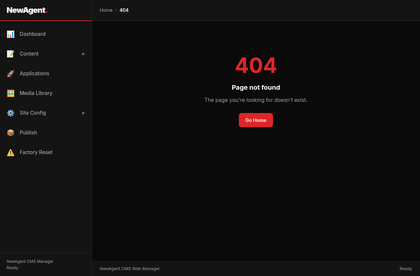
*_Figure 9: NewAgent CMS Media Library & Asset Manager_*

The Media cube organizes static assets, image dropzones, and thumbnail caches with content-hashed file storage.

---


*_Figure 10: NewAgent CMS Navigation & Interface Settings_*

The Interface cube configures site navigation trees, drawer menus, and spatial design layouts across publication themes.

---


*_Figure 11: NewAgent CMS Site Configuration Registry_*

The Site Configuration view exposes persistent operational variables and debug toggles backed by atomic BEJSON 104a writes.

---

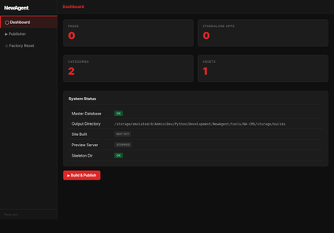
*_Figure 12: NewAgent CMS Static Site Publisher Dashboard_*

The Publisher dashboard monitors static export pipelines, stylesheet selections, and deployment targets.

---

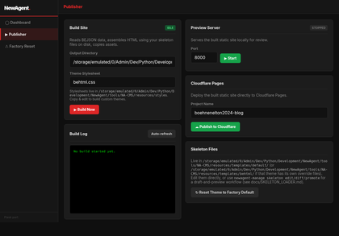
*_Figure 13: NewAgent CMS Build & Preview Console (`/publish`)*_

The Build Console triggers static site generation, executes pre-publish validation gates, and runs local HTTP preview servers.

---

# Phase 2: Technical Architecture & System Specifications

## System Architecture & Pipeline Topology

NewAgent utilizes a decoupled architecture where user interfaces, context generation, model communication, and filesystem operations interact through formal stage gates:

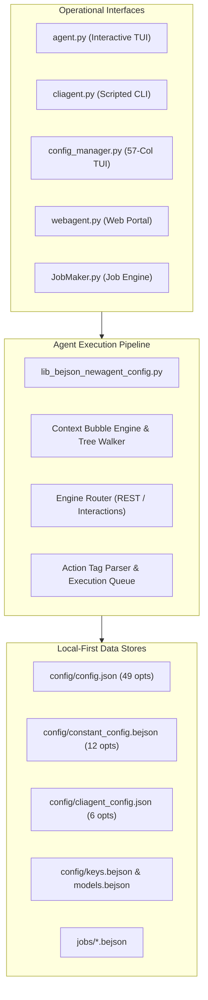

---

## Dual AI Execution Engines & Provider Routing

NewAgent supports two distinct model dispatch engines configurable via the `engine_mode` parameter:

### 1. Asynchronous Multi-Key REST Engine (`engine_mode: rest`)
- **Direct REST Integration**: Uses zero external client SDKs to communicate directly with standard REST endpoints.
- **Automated Key Rotation & Circuit Breaker**: Evaluates API keys sequentially across your configured pool, automatically marking failing keys with cooldown timestamps in `config/key_state.bejson` and rotating to healthy keys.
- **Dynamic Catalog Discovery**: Queries OpenRouter models to identify free-tier and specialized architectures on demand.

### 2. Google Interactions Stateful Engine (`engine_mode: interactions`)
- **Stateful Function Calling**: Binds native tool declarations directly into the Gemini Interactions API loop.
- **Tool Scoping**: Parameterized via `native_tools_scope` (`all` or `shell_only`) to constrain execution surfaces for specialized tasks.

---

## Context Bubble Engine & Tree-Walking Persistent Directives

The Context Bubble pipeline (`lib_bejson_newagent_context_bubble.py`) generates a dynamic, budget-quantized prompt payload (`Context_Bubble.md`) on every conversational turn.

### Budget Allocation Model
Context memory is partitioned according to percentage weights defined in `config/constant_config.bejson`:

| Constant Key | Default Share | Description |
| :--- | :--- | :--- |
| `pct_persistent_policy` | 20% | Standing directives and identity rules |
| `pct_active_tasks` | 20% | Task context from active job checklists |
| `pct_env_file` | 5% | Live environment variables and definitions |
| `pct_keyword_triggers` | 30% | File context triggered by matched query keywords |
| `pct_knowledge_pool` | 15% | Periodic knowledge pool drips |
| `pct_cwd_context` | 10% | Local workspace context (`context.bejson`) |

### Hierarchical Tree-Walking Persistent Directives
When `gemini_md_policy_enabled` is set to `true`, NewAgent dynamically discovers and merges persistent project directives across the filesystem:

1. **Global Baseline**: Loads the primary global configuration directives from the user environment directory.
2. **Root-to-CWD Tree Walker**: Scans every ancestor directory from the filesystem root `/` down to the active working directory for project instructions (`AGENTS.md` and `agents.md`).
3. **SHA-256 Deduplication**: Identifies identical files by both canonical path and cryptographic hash to prevent duplicate content injection.
4. **Leaf Budget Reservation**: Prioritizes character budget for workspace-local project rules first so project instructions are never starved by global files.
5. **Interactive Controls**: Toggleable on the fly via `/geminimd [on|off|status]`.

---

## Antigravity (agy) Skills Compatibility Layer

NewAgent includes a native compatibility layer for Antigravity (`agy`) `SKILL.md` bundles (`lib_bejson_newagent_agy_skills.py`), gated by the `agy_skills_enabled` setting in `config/config.json`.

- **Discovery**: Automatically scans configured skill directories (`~/.gemini/config/skills`, built-in skill directories) for valid `SKILL.md` manifests.
- **Context Injection**: Selects relevant skills based on prompt intent and injects concise instruction briefs into the context bubble.
- **Action Tag Execution**: Handles `<agy_skill action="list|read|run" name="..." script="..." args="..."/>` commands during agent turns.
- **Slash Command Controls**: Operators can inspect and toggle skills via `/skills [on|off|list|info <name>]`.

---

## 57-Column BEJSON Positional Telemetry Configuration Manager

Built strictly to the **BEJSON Positional Telemetry Discipline**, `config_manager.py` eliminates visual entropy on mobile portrait screens (such as Termux) by enforcing a strict **57-column viewport ceiling**.

```text
=========================================================
 NEWAGENT CONFIG [104a]         ~/.../config/config.json
---------------------------------------------------------
 ENGINE SKILLS GEM_MD SUBAGT GATE  DRY   DBG   MODS    
 rest   OFF    OFF    OFF    OFF   OFF   ON    1/67    
---------------------------------------------------------
 BUBBLE  OBSVR  AUTOC  TURNS   TIMEO  RETRY  STATE     
 8000t   OFF    ON     20/12   60s    ON     READY     
---------------------------------------------------------
 ID CAT STORE       ITEMS MOD CATEGORY_DOMAIN          
 01 ENG config.json 11    0   Engine & Generation      
 02 AUT config.json 09    0   Autonomy & Execution     
 03 MEM config.json 08    0   Memory, Policy & Subagt  
 04 EXT config.json 09    0   Skills, Libs & Env Path  
 05 SYS config.json 12    0   TUI, IO, Net & Web Auth  
 06 BUB constant.bj 12    1   Context Bubble & Obsvr   
 07 CLI cliagent.js 06    0   Headless CLIAgent Opts   
=========================================================
 [1-7] Open Cat     [T] Quick Toggle   [F] Find Option   
 [V] Validate 104a  [P] Probe Paths    [K] Snapshot Bak  
 [R] Reset All Def  [A] About Tool     [Q] Quit & Sync   
=========================================================
```

### Key Architectural Pillars:
- **Positional Telemetry Strips**: Decouples uppercase `Fields` headers from positional `Values` rows, eliminating repetitive `Key: Value |` clutter.
- **7 Domain Categories**: Intelligently groups all **67 options** across `config/config.json`, `config/constant_config.bejson`, and `config/cliagent_config.json`.
- **Zero-Typing Presets & Toggles**: Pressing `[T]` immediately flips boolean switches or cycles enum options without typing text. Numeric budgets and timeouts offer numbered preset choices (`1..9`).
- **Termux File Picker Integration**: Path selection uses graphical Android file dialogs (`termux-dialog`), aborting with deterministic exit code `10` if pickers fail or time out.
- **In-Agent Access**: Available inside live conversations via the `/cfgmenu` command.

---

## Unified Tooling Architecture & Library Synchronization

The `tools/` directory hosts modular standalone tools that share core runtime libraries without duplicate dependency copies:

- **`tools/NA-CMS`**: Full-featured static publishing CMS and MFDB database manager.
- **`tools/NA-Chunker`**: High-speed repository and directory chunking utility for BEJSON text archives.
- **`tools/NA-MD2HTML`**: Standalone Markdown-to-BEHTML compiler with responsive grid formatting.
- **`tools/NA-WebToolkit`**: Playwright and Chromium-backed web scraper and asset extractor.
- **`tools/NA-Init`**: Workspace scaffolding and project initialization generator.

### Library Architecture
- **Shared Core (`lib/`)**: Houses the 7 canonical Release 300 Core BEJSON modules (`bejson_core`, `validator`, `chunking`, `nesting`, `encryption`, `error_registry`, `nesting_query`).
- **Extended Ecosystem (`lib_extensions/`)**: Houses all 48 Release 300 BEJSON libraries (`Core`, `MD`, `HTML`, `CMS`, `MFDB`, `Diagram`, `Prompt`, `Registry`, `Theme`, `Weave`, `Web`) plus CMS ports.
- **Per-Tool Dynamic Resolution**: Tools configure relative library paths (`shared_lib_directory`, `lib_extensions_directory`) in their local `config.json` without hardcoding machine-specific locations.

---

## BEJSON & MFDB Persistence Standards

All NewAgent state stores adhere to Elton Boehnen's BEJSON format standards:

### BEJSON 104a Table Model
Stores schema column names and types once in a `Fields` array, serializing row entries as compact positional arrays in `Values`:
```json
{
  "Format": "BEJSON",
  "Format_Version": "104a",
  "Format_Creator": "Elton Boehnen",
  "Records_Type": ["ScriptConfig"],
  "Fields": [
    {"name": "setting_name", "type": "string"},
    {"name": "setting_value", "type": "string"},
    {"name": "description", "type": "string"}
  ],
  "Values": [
    ["engine_mode", "rest", "Active engine: 'rest' or 'interactions'"],
    ["auto_continue_enabled", "true", "Auto-feed action results back to model"]
  ]
}
```

- **Atomic Writes**: Updates write to `.tmp` files before atomic POSIX replacement to protect against data corruption during power interruptions.
- **O(1) Field Map Caching**: Compiles field name-to-index mappings upon read, eliminating linear column search overhead.

---

## CLI Flag & Command Matrix

### `agent.py` & Slash Commands
| Command | Arguments | Function |
| :--- | :--- | :--- |
| `/help` | `[topic]` | Displays data-driven help registry |
| `/cfgmenu` | `[1-7\|cat\|get\|set\|toggle]` | Launches or queries 57-column configuration manager |
| `/geminimd` | `[on\|off\|status]` | Toggles global + tree-walking persistent policy |
| `/skills` | `[on\|off\|list\|info]` | Manages Antigravity (`agy`) skills layer |
| `/engine` | *none* | Toggles between REST and Interactions engines |
| `/gate` | *none* | Toggles interactive confirmation before risky commands |
| `/amnesia` | *none* | Compresses live history and flushes memory to recap |
| `/rebirth` | *none* | Re-seeds agent memory with the last compressed recap |
| `/stats` | *none* | Displays session token consumption and call metrics |

### `config_manager.py` CLI Options
| Flag | Arguments | Description |
| :--- | :--- | :--- |
| `--config` | `[path]` | Displays 57-column root dashboard |
| `--category` | `<1-7\|CODE>` | Renders a specific category submenu |
| `--get` | `<key>` | Inspects an option with its preset values |
| `--set` | `<key> <val>` | Sets a configuration value atomically |
| `--toggle` | `<key>` | Toggles boolean or cycles enum/preset options |
| `--validate` | *none* | Validates all 3 BEJSON stores (Exit code 0 or 30) |
| `--probe` | *none* | Probes filesystem paths and directories |
| `--backup` | *none* | Creates timestamped snapshot backups in `backups/` |
| `--reset` | *none* | Restores all 67 options to factory defaults |
| `--about` | *none* | Displays project metadata and author credits |

---

## Testing, Verification & Playwright Automated Suites

NewAgent includes an automated test harness covering concurrency, security, schema validation, and web interfaces.

### Running Automated Pytest Suites
```bash
python3 -m pytest tests/ -q
```
*Current test suite status: **167 passed**.*

### Running Automated Playwright Browser Tests
NewAgent uses native Termux Playwright (`termux_playwright`) to test its web interfaces without external dependencies:

```bash
python3 run_flask_playwright_suite.py
```
This suite automatically:
1. Boots `webagent.py`, `JobMaker.py`, `NewAgent_CMS_Admin.py`, and `NewAgent_CMS_Publisher.py` on dedicated ports.
2. Awaits HTTP readiness and authenticates via security tokens and Basic Auth.
3. Executes automated UI navigation, clicks interactive tabs, and populates form fields.
4. Captures full-page screenshots into `agds/` and mirrors downscaled 420px assets to `images/screenshots/`.
5. Reaps all server subprocesses and browser instances cleanly upon completion.

---

<footer>
Author: Elton Boehnen · boehnenelton2024@gmail.com · boehnenelton2024.pages.dev · github.com/boehnenelton
</footer>
