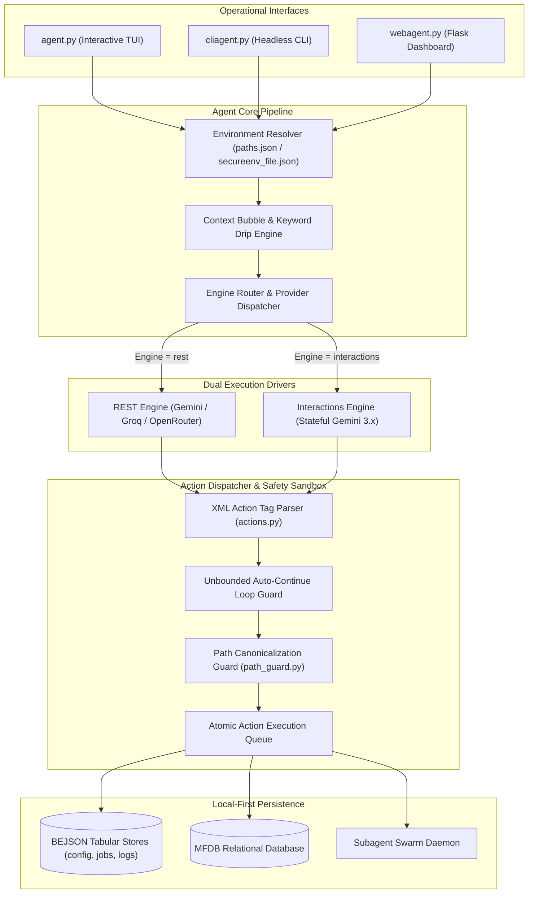

#Tags #NewAgent #AIAgent #BEJSON #MFDB #Subagents

## Title: NewAgent — High-Performance Async AI Coding Agent & Multi-Engine Ecosystem

> Ground-up, asynchronous AI coding assistant, autonomous task execution agent, and multi-engine orchestration framework featuring dual REST and Gemini Interactions API drivers, dynamic OpenRouter catalog discovery, subagent delegation, zero-leakage in-memory key resolution, BEJSON/MFDB local-first persistence, and interactive Web/CLI/TUI interfaces.

[]()
[]()
[]()
[]()
[]()
[](LICENSE)

---

## Credits

**Author & Core Architect:** Elton Boehnen  
**Email:** [boehnenelton2024@gmail.com](mailto:boehnenelton2024@gmail.com)  
**Website:** [boehnenelton2024.pages.dev](https://boehnenelton2024.pages.dev)  
**GitHub:** [github.com/boehnenelton](https://github.com/boehnenelton)  
**Format Creator & Ecosystem Maintainer:** Elton Boehnen  
**Document Fingerprint / Relational ID:** `a84c9f12-0012-4f81-9b04-3e911284a105`  
**Package Release Version:** v3.45.0 / Package PKG 129 (October 2026)  

---

## Table of Contents

- [Executive Summary](#executive-summary)
- [Context Clarification & Naming Heritage](#context-clarification--naming-heritage)
- [System Architecture & Topology](#system-architecture--topology)
- [Comprehensive Feature List](#comprehensive-feature-list)
- [Subsystem Index & Directory Layout](#subsystem-index--directory-layout)
- [Operational Interfaces](#operational-interfaces)
  - [1. Interactive Terminal Agent (`agent.py`)](#1-interactive-terminal-agent-agentpy)
  - [2. Headless Scriptable Daemon (`cliagent.py`)](#2-headless-scriptable-daemon-cliagentpy)
  - [3. Web Inspection Portal (`webagent.py`)](#3-web-inspection-portal-webagentpy)
  - [4. Task Workflow & Job Engine (`JobMaker.py`)](#4-task-workflow--job-engine-jobmakerpy)
  - [5. Subagent Administrator (`subagent_admin.py`)](#5-subagent-administrator-subagent_adminpy)
- [Execution Engines & Provider Routing](#execution-engines--provider-routing)
  - [Multi-Provider REST Engine & Key Rotation](#multi-provider-rest-engine--key-rotation)
  - [Gemini Interactions Stateful Engine](#gemini-interactions-stateful-engine)
  - [OpenRouter Dynamic Free Model Discovery](#openrouter-dynamic-free-model-discovery)
- [Security & Zero-Leakage Architecture](#security--zero-leakage-architecture)
- [Data-Driven Slash Command & Help System](#data-driven-slash-command--help-system)
- [Action Tag Specification & Sandboxing](#action-tag-specification--sandboxing)
- [BEJSON & MFDB Persistence Specifications](#bejson--mfdb-persistence-specifications)
- [Integrated Standalone Tools Suite](#integrated-standalone-tools-suite)
- [Installation & Environment Setup](#installation--environment-setup)
- [Automated Verification & Test Harness](#automated-verification--test-harness)
- [Troubleshooting & Diagnostic Guide](#troubleshooting--diagnostic-guide)
- [Non-Commercial License](#non-commercial-license)

---

## Executive Summary


**NewAgent** is a production-grade, asynchronous AI coding assistant, autonomous agentic workspace manager, and multi-engine orchestration framework. Designed from the ground up for Python 3.10+ runtimes across Linux, macOS, and Android (Termux) environments, NewAgent combines high-throughput AI inference with strict local-first data persistence discipline.

Unlike traditional AI developer tools that rely on opaque cloud platforms or litter host filesystems with unstructured JSON debris, NewAgent embeds Elton Boehnen's **BEJSON (Boehnen Elton JSON)** data architecture and **MFDB (Multi-File Database)** relational standards directly into its core execution loop. Every configuration file, conversation session, subagent profile, task card, and knowledge trigger is stored locally in clean, zero-overhead tabular structures.

### Foundational Pillars:
1. **Dual AI Execution Drivers:** Seamlessly toggle between multi-key asynchronous REST execution (Gemini, Groq, OpenRouter) and next-generation stateful Google Interactions API (`gemini-3.x`).
2. **Zero-Leakage Security Model:** Physical caches store abstract environment pointers (`ENV:<var_name>`), keeping real API keys purely in memory and eliminating accidental secret disclosure.
3. **Data-Driven Extensibility:** Completely configurable slash command registry, help topics, model catalogs, and context drip rules defined in strict BEJSON datasets.
4. **Resilient Local Persistence:** O(1) Field Map lookups, atomic `.tmp` file updates, and directory-based relational databases without SQL server dependencies.
5. **Comprehensive Test Conformance:** Backed by 131 automated unit and regression tests verifying concurrency locks, schema integrity, and fault tolerance.

---

## Context Clarification & Naming Heritage

To eliminate naming ambiguity across prompts, documentation, and source code:

- **BEJSON (Boehnen Elton JSON):** Created by Elton Boehnen. A strict tabular structured data serialization format. By decoupling column declarations (`Fields`) from raw row records (`Values`), BEJSON slashes token consumption by 40%–70%, eliminates repeating dictionary keys, provides O(1) positional lookups, and eradicates structural LLM hallucinations.
- **MFDB (Multi-File Database):** Created by Elton Boehnen. A serverless relational database architecture that links discrete BEJSON table files via foreign key pointers (`_fk`) and manifest topologies (`bejson_project.json`), delivering complete relational querying directly on local storage.

---

## System Architecture & Topology


NewAgent employs a modular, event-driven pipeline that decouples interface surfaces, context assembly, execution drivers, action tag processing, and persistence:



---

## Comprehensive Feature List

### Core AI & Multi-Engine Orchestration
- 🤖 **Dual Execution Drivers:** Toggle on the fly between the multi-provider asynchronous REST engine and the stateful Google Gemini Interactions API driver.
- 🔄 **Autonomous Multi-Key Rotation:** Automatically rotates across 25 Gemini keys (`GEMINI_KEY_1..25`), 10 Groq keys (`GROQ_KEY_1..10`), and 13 OpenRouter keys (`OPENROUTER_KEY_1..13`) upon encountering HTTP 429 (Rate Limit) or 5xx quotas.
- ⚡ **OpenRouter Free Model Discovery:** Real-time `/model sync` and `/model refresh` slash commands dynamically poll OpenRouter's API, filter free models (`:free` / `-free`), and update catalogs without touching core static providers.
- 🛡️ **Unbounded Auto-Continue Loop Guard:** Detects repetitive command batches, echo-only loops, and terminates execution safely upon reaching `max_auto_continue_turns` (default 12) via `actions_signature()`.
- 🧹 **Chain-of-Thought Content Hygiene:** Automatically filters leaked `<think>` reasoning blocks and sends `reasoning={exclude:true}` to prevent non-Gemini provider parsing failures.

### Local-First BEJSON & MFDB Persistence
- 📊 **Tabular Positional Layout:** Decouples field headers from row values, yielding 40%–70% token reductions and expanding effective context windows.
- 🚀 **O(1) Field Map Caching:** In-memory field-to-index maps eliminate dictionary key scanning overhead and enable instantaneous random access.
- 📁 **Zero-Server Relational Database:** MFDB links independent `.104.bejson` tables using foreign keys (`_fk`) and manifest manifests (`bejson_project.json`) without SQL servers.
- 🔒 **Atomic Filesystem Safety:** All file writes use temporary `.tmp` write buffers and atomic `os.replace` commits, preventing file truncation on unexpected crashes.

### Sandboxed Action Tag Engine
- 🛠️ **Full XML Action Vocabulary:** Safe execution of `<read_file>`, `<write_file>`, `<patch_file>`, `<diff_file>`, `<run_command>`, `<bejson_create>`, `<bejson_add_field>`, `<bejson_create_record>`, `<subagent_spawn>`, and `<subagent_signal>`.
- 🛡️ **Path Canonicalization Guard:** Validates all file targets against `lib_bejson_Core_bejson_path_guard.py` to prevent unauthorized directory traversal (`../`).
- ⏱️ **Command Output Truncation:** Subprocess outputs captured via `<run_command>` are capped to a configurable safe limit (100 KB) to prevent out-of-memory errors.

### Context Bubble & Keyword Dripping
- 🎯 **Priority Keyword Dripping:** Dynamic keyword scanning (`config/triggers.bejson`) matches user prompts and injects targeted documentation on demand.
- ⚖️ **Weight-Biased Rotation:** Rotates knowledge entries based on assigned priority weights (1 = high priority every turn; 3 = periodic low priority).
- 📉 **Budget-Capped Truncation:** Strict mathematical context ceiling calculation truncates oldest history turns first while permanently protecting active system policies.

### Multi-Agent Swarms & Subagent Delegation
- 👥 **Isolated Subagent Runtimes:** Background worker subagents maintain private session logs, independent token budgets, and sandboxed role profiles.
- 📡 **Inter-Agent Signal Queues:** Subagents communicate with parent agents via structured events (`STARTED`, `PROGRESS`, `COMPLETE`, `ERROR`).
- 📋 **JobMaker Task Card Engine:** Breaks complex software projects into 104a task checklists with mandatory pre-delivery self-critical audits.

### Interfaces & Developer Tooling
- 💻 **Interactive Terminal TUI (`agent.py`):** High-contrast color-coded interface with live token streaming, command autocomplete, and instant session exports.
- ⚙️ **Scriptable Headless Runner (`cliagent.py`):** Designed for cron jobs, background processes, and automated CI/CD task execution.
- 🌐 **Web Inspection Portal (`webagent.py`):** Flask dashboard providing real-time chat, quickjump file navigation, and job card inspection.
- 📚 **Data-Driven Help System:** `/help`, `/help <topic>`, and `/<command> help` driven dynamically by `config/help.bejson`.
- 🧪 **131 Passing Automated Tests:** Full test suite verifying locking concurrency, engine routing, validator integrity, and hardening patches.

---

## Subsystem Index & Directory Layout


```
NewAgent/
├── agent.py                                    # Interactive Terminal TUI Entrypoint
├── cliagent.py                                 # Headless Scriptable Daemon Entrypoint
├── webagent.py                                 # Flask Web Inspection Surface
├── JobMaker.py                                 # Task Workflow & Job Card Manager
├── subagent_admin.py                           # Subagent Profile & Session Administrator
├── context.bejson                              # Core Context Memory & Dynamic Knowledge Store
├── requirements.txt                            # Python Package Dependency Roster
├── .bejson_project.json                        # BEJSON v1.6.0/v1.7.0 Repository Manifest
├── .gitignore                                  # Git Exclusion Rules (Secrets, Caches, Logs)
├── lib/                                        # Core Library & Driver Subsystem
│   ├── lib_bejson_Core_bejson_core.py          # BEJSON 104/104a Parser & Field Map Cache
│   ├── lib_bejson_Core_bejson_env.py           # Canonical Environment Sourcing Resolver
│   ├── lib_bejson_Core_bejson_errors.py        # Centralized Error Code Registry
│   ├── lib_bejson_Core_bejson_path_guard.py    # Path Canonicalization & Security Guard
│   ├── lib_bejson_Core_bejson_validator.py     # Schema Validation & Type Verification
│   ├── lib_bejson_Core_mfdb_core.py            # MFDB Relational Orchestration Engine
│   ├── lib_bejson_Core_mfdb_validator.py       # MFDB Manifest & Entity Schema Inspector
│   ├── lib_bejson_newagent_actions.py          # Action Tag XML Parser & Dispatcher
│   ├── lib_bejson_newagent_commands.py         # Slash Command Processor & Engine Switching
│   ├── lib_bejson_newagent_config.py           # Configuration & Secure Credentials Loader
│   ├── lib_bejson_newagent_context_bubble.py   # Context Bubble & Keyword Drip Math Engine
│   ├── lib_bejson_newagent_engine_interactions.py # Gemini Interactions Stateful API Driver
│   ├── lib_bejson_newagent_engine_rest.py      # Multi-Provider REST API Driver & Key Rotator
│   ├── lib_bejson_newagent_help.py             # Data-Driven Help Registry Engine
│   ├── lib_bejson_newagent_jobs.py             # 104a Job Schema & Task State Machine
│   └── lib_bejson_newagent_session.py          # Session Logging & Serialized Exports
├── config/                                     # BEJSON Configuration Data Stores
│   ├── config.json                             # Runtime Agent Configuration Defaults
│   ├── help.bejson                             # Data-Driven Help Topic & Command Registry
│   ├── models.bejson                           # Active Model & Provider Settings
│   ├── gemini_catalog.bejson                   # Model Catalog Roster (Gemini & OpenRouter)
│   ├── triggers.bejson                         # Keyword Trigger Registry for Context Drips
│   └── knowledge_pool.bejson                   # Curated Knowledge Snippets & Weight Table
├── env_templates/                              # Environment Bootstrap Templates
│   ├── paths.template.json                     # Non-Sensitive User Paths Template
│   └── secureenv_file.template.json            # API Keys & Secrets Roster Template
├── tests/                                      # Automated Regression Test Suite
│   ├── test_autocontinue_guard_pkg128.py       # Auto-Continue Loop Prevention Tests
│   ├── test_help_registry_pkg127.py            # Data-Driven Help Registry Tests
│   ├── test_hardening_pkg126.py                # Hardening, Trailing Newlines & CWD Tests
│   ├── test_audit_remediation_pkg125.py        # Key Ledger & Secret Exclusion Tests
│   ├── test_openrouter_engine_integration.py   # OpenRouter Dynamic Sync & Routing Tests
│   ├── test_locking_resilient_pid.py           # Multi-Thread Concurrency Lock Tests
│   └── test_mfdb_core_write_checks.py          # Atomic Write Verification Tests
├── tools/                                      # Integrated Standalone Tooling
│   ├── NA-Init/CLI_Init.py                     # Project Workspace Initializer
│   ├── NA-Chunker/CLI_Chunker.py               # Macro-Repository BEJSON Chunker
│   ├── NA-MD2HTML/MD_To_HTML.py                # Publication Editorial HTML Generator
│   ├── NA-WebToolkit/Cli_Web_Toolkit.py        # Headless Web Scraper & HTML Parser
│   └── NA-CMS/advanced_launcher.py             # BEJSON Micro Content Management Portal
├── dev/                                        # Development Checklists & Audit Logs
├── docs/                                       # Technical Overview Documentation
└── images/                                     # System Topology & Architecture Slides
```

---

## Operational Interfaces

### 1. Interactive Terminal Agent (`agent.py`)

The primary daily driver for pair programming, refactoring, and codebase auditing:

```bash
# Launch interactive session with default REST engine
python3 agent.py

# Launch with an initial prompt
python3 agent.py --prompt "Audit all Python modules under lib/ for path safety"

# Launch using the Gemini Interactions API driver
python3 agent.py --engine interactions --model gemini-3.5-flash-lite

# Launch with verbose debug telemetry enabled
python3 agent.py --debug
```

#### Core Slash Commands:
| Command | Arguments | Description |
| :--- | :--- | :--- |
| `/help` | `[topic \| command]` | Displays data-driven help index or specific topic breakdown |
| `/model` | `[number \| sync \| refresh]` | Selects active model or synchronizes live free OpenRouter models |
| `/engine`| `[rest \| interactions]` | Switches execution engine between REST and Interactions API |
| `/context`| None | Inspects active context bubble, loaded triggers, and token weights |
| `/export` | None | Exports current conversation to a timestamped Markdown transcript |
| `/jobs` | None | Displays active JobMaker task cards and status |
| `/subagents`| None | Lists running background subagents and signal queues |
| `/clear` | None | Flushes conversation history while preserving core policies |
| `/exit` | None | Safely concludes the session and commits state |

### 2. Headless Scriptable Daemon (`cliagent.py`)

Designed for non-interactive execution, background worker tasks, and CI/CD pipelines:

```bash
# Execute a single headless prompt
python3 cliagent.py --prompt "Generate unit test suite for lib_bejson_newagent_config.py"

# Execute with explicit max-turn cap and redirect log to file
python3 cliagent.py --prompt "Run full test suite" --max-turns 8 --output logs/ci_run.log

# Execute headless task with custom configuration file
python3 cliagent.py --config config/custom_config.json --prompt "Verify schema integrity"
```

### 3. Web Inspection Portal (`webagent.py`)

Launches a single-port local web dashboard providing chat controls, file inspection, and job tracking:

```bash
# Launch web portal on default localhost port 5000
python3 webagent.py

# Launch on custom network interface and port
python3 webagent.py --host 0.0.0.0 --port 8080
```

Navigate to `http://localhost:5000` to interact with the agent via an intuitive browser interface.

### 4. Task Workflow & Job Engine (`JobMaker.py`)

Author, step through, and audit structured 104a task checklists:

```bash
# Launch interactive JobMaker TUI
python3 JobMaker.py

# Create a new job card from template
python3 JobMaker.py create --template templates/refactor_job.bejson --job-name "Refactor_Logging"

# Step to the next pending subtask
python3 JobMaker.py step --job-id "JOB-20261016-01"

# Execute pre-delivery self-critical verification audit
python3 JobMaker.py audit --job-id "JOB-20261016-01"
```

### 5. Subagent Administrator (`subagent_admin.py`)


Manage subagent worker profiles, inspect active subagent execution threads, and audit signals:

```bash
# List all registered subagent profiles
python3 subagent_admin.py list-profiles

# Register a new specialized profile
python3 subagent_admin.py create-profile --name "SecurityAuditor" --role "Audits code for vulnerabilities"

# Inspect active subagent sessions and turn budgets
python3 subagent_admin.py list-sessions

# Terminate an active subagent session
python3 subagent_admin.py kill-session --session-id "SUB-20261016-001"
```

---

## Execution Engines & Provider Routing

### Multi-Provider REST Engine & Key Rotation
- **Supported Providers:** Google Gemini, Groq Cloud, OpenRouter.
- **Failover Logic:** Automatic circuit breaker rotates keys upon encountering HTTP 429 (Rate Limit) or HTTP 5xx errors.
- **Secret Roster:** Dynamically binds `GEMINI_KEY_1..25`, `GROQ_KEY_1..10`, and `OPENROUTER_KEY_1..13`.

### Gemini Interactions Stateful Engine
- **State Preservation:** Uses Google's `previous_interaction_id` to maintain conversation continuity across turns without re-transmitting entire history payloads.
- **Native Tool Calling:** Maps NewAgent XML action tags directly into Google Interactions tool signatures.

### OpenRouter Dynamic Free Model Discovery
- **Live Catalog Sync:** Running `/model sync` or `/model refresh` queries OpenRouter's live API endpoint, extracts models offering free prompt/completion tiers (or bearing the `:free`/`-free` suffix), and appends them dynamically to `config/gemini_catalog.bejson`.
- **Static Slot Protection:** Primary Gemini models (slots 1–3) and flagship models (slots 4–10) remain permanently stable, while dynamic models populate slots 11+.

---

## Security & Zero-Leakage Architecture


NewAgent implements a hardened, zero-leakage security model engineered specifically to prevent secret leaks and path traversal attacks:

1. **In-Memory Secret Resolution (`ENV:<var_name>`):** Physical cache files (`config/keys.bejson`, `config/keys_openrouter.bejson`) store only abstract environment variable references. Real credentials are read from `/storage/emulated/0/.env/secure/secureenv_file.json` and held strictly in RAM. Exported archives and git commits remain 100% free of plaintext API keys.
2. **Path Canonicalization Guard:** All file actions (`<read_file>`, `<write_file>`, `<patch_file>`) are validated against `lib_bejson_Core_bejson_path_guard.py`, blocking directory traversal (`../`) and unauthorized host escapes.
3. **Loop Runaway Prevention:** `actions_signature()` monitors consecutive turn execution; if the model loops on echo-only commands or identical repeated batches, the agent halts auto-continue and requests operator intervention.
4. **Subprocess Sandboxing:** Subprocess stdout/stderr captured by `<run_command>` is strictly capped at 100 KB to eliminate buffer overflow vectors.

---

## Data-Driven Slash Command & Help System

Beginning with **v3.43.0 (PKG 127)**, NewAgent features a completely decoupled, data-driven help registry driven by `config/help.bejson` and `lib/lib_bejson_newagent_help.py`.

```json
{
  "Format": "BEJSON",
  "Format_Version": "104",
  "Records_Type": ["HelpTopic"],
  "Fields": [
    {"name": "help_id",     "type": "string"},
    {"name": "command",     "type": "string"},
    {"name": "help_topic",  "type": "string"},
    {"name": "summary",     "type": "string"},
    {"name": "usage",       "type": "string"},
    {"name": "description", "type": "string"}
  ],
  "Values": [
    ["help_model", "/model", "models", "Select or sync AI models", "/model [number|sync]", "Switches active AI model or synchronizes free OpenRouter models."]
  ]
}
```

- **Grouped Overview:** `/help` renders an organized breakdown across 9 core topics (`general`, `models`, `keys`, `files`, `session`, `context`, `input`, `safety`, `jobs`).
- **Topic Detail:** `/help models` lists all commands, parameters, and provider notes belonging to the `models` topic.
- **Command Detail:** Both `/help /model` and `/model help` display comprehensive syntax, arguments, and practical usage examples.

---

## Action Tag Specification & Sandboxing

NewAgent executes atomic filesystem, terminal, and database operations through structured XML action tags:

| Action Tag | Attributes | Payload / Child Elements | Description |
| :--- | :--- | :--- | :--- |
| `<read_file>` | `path` | None | Reads and returns full file content |
| `<write_file>` | `path`, `overwrite` | File content string | Atomically writes file via `.tmp` swap |
| `<patch_file>` | `path` | Unified diff block | Applies patch hunk to existing file |
| `<diff_file>` | `path` | None | Displays uncommitted changes for a file |
| `<run_command>`| `cwd`, `timeout` | Shell command string | Runs command in subshell with capped output |
| `<bejson_create>`| `path`, `records_type` | BEJSON Fields JSON | Scaffolds compliant 104a BEJSON table |
| `<bejson_add_field>`| `path`, `name`, `type`| None | Appends column to Fields array |
| `<subagent_spawn>`| `profile`, `name` | Initial system prompt | Launches background worker subagent |
| `<subagent_signal>`| `session_id` | Signal & payload | Sends message to active subagent |

---

## BEJSON & MFDB Persistence Specifications


### BEJSON 104a Layout Standard
```json
{
  "Format": "BEJSON",
  "Format_Version": "104a",
  "Format_Creator": "Elton Boehnen",
  "Records_Type": ["AgentConfig"],
  "Fields": [
    {"name": "setting_name",  "type": "string"},
    {"name": "setting_value", "type": "any"},
    {"name": "description",   "type": "string"}
  ],
  "Values": [
    ["active_engine",        "rest",             "Default execution engine."],
    ["default_model",        "gemini-2.5-flash", "Default model ID."],
    ["max_turn_budget",      25,                 "Max turns per session."],
    ["context_token_limit",  16000,              "Token ceiling."]
  ]
}
```

### O(1) Positional Lookups via Field Map Cache
```python
# lib_bejson_Core_bejson_core.py
field_map = bejson_core_get_field_map(doc)
# O(1) constant-time column lookup across any row
setting_val = row[field_map["setting_value"]]
```

---

## Integrated Standalone Tools Suite

NewAgent includes five standalone utility applications located in [`tools/`](file:///storage/emulated/0/User/workspace/Python/NewAgent/tools):

1. **NA-Init (`tools/NA-Init/CLI_Init.py`):** Scaffolds standardized BEJSON workspace directories (`lib/`, `config/`, `data/`, `dev/`, `docs/`, `logs/`) and writes default manifests.
2. **NA-Chunker (`tools/NA-Chunker/CLI_Chunker.py`):** Packs entire multi-directory software projects into a single `.bejsonchunk` file for instant single-shot AI ingestion.
3. **NA-MD2HTML (`tools/NA-MD2HTML/MD_To_HTML.py`):** Transforms Markdown reports into publication-grade HTML documents featuring Elton Boehnen's signature editorial theme (#DE2626 red accent, Lora typography).
4. **NA-WebToolkit (`tools/NA-WebToolkit/Cli_Web_Toolkit.py`):** Headless web fetcher and HTML text extractor for automated documentation gathering.
5. **NA-CMS (`tools/NA-CMS/advanced_launcher.py`):** Micro headless content management portal driven entirely by BEJSON 104a tabular records.

---

## Installation & Environment Setup

### 1. Prerequisites
- Python `>= 3.10`
- Git, cURL, jq, OpenSSL
- Termux on Android, or standard Linux/macOS terminal

### 2. Sourcing Environment Configuration
NewAgent sources paths and secrets from canonical environment files:
- **Secure Credentials:** `/storage/emulated/0/.env/secure/secureenv_file.json`
- **User Non-Sensitive Paths:** `/storage/emulated/0/.env/user/paths.json`

```bash
# Verify environment files exist
ls -la /storage/emulated/0/.env/secure/secureenv_file.json
ls -la /storage/emulated/0/.env/user/paths.json
```

### 3. Install Dependencies
```bash
python3 -m pip install -r requirements.txt
```

---

## Automated Verification & Test Harness

NewAgent maintains a comprehensive test suite executed via `pytest`:

```bash
# Run complete test suite (131 tests)
pytest tests/ -v
```

```
============================= 131 passed in 6.07s ==============================
```

- `test_autocontinue_guard_pkg128.py`: Validates loop runaway prevention and echo suppression.
- `test_help_registry_pkg127.py`: Asserts complete data-driven help coverage and schema conformance.
- `test_hardening_pkg126.py`: Verifies trailing newline handling, URL scheme gating, and fd probe caching.
- `test_audit_remediation_pkg125.py`: Tests key ledger authority and secret masking.
- `test_openrouter_engine_integration.py`: Validates free model discovery, provider switching, and `/model sync`.
- `test_locking_resilient_pid.py`: Verifies concurrent multi-thread file locking.
- `test_mfdb_core_write_checks.py`: Verifies atomic write integrity and error raising.

---

## Troubleshooting & Diagnostic Guide

<details>
<summary><strong>Q: Why does NewAgent report "No API keys available for provider gemini"?</strong></summary>

*A: Check that `/storage/emulated/0/.env/secure/secureenv_file.json` contains valid, active `GEMINI_KEY_*` rows. Verify that `env_secure_file_path` in `config/config.json` points to the correct location.*
</details>

<details>
<summary><strong>Q: How do I switch to a free OpenRouter model?</strong></summary>

*A: Type `/model sync` in an interactive terminal session to pull the latest free models, then type `/model <number>` to activate your choice. NewAgent automatically switches the engine to REST mode.*
</details>

<details>
<summary><strong>Q: How do I resolve a `<bejson_create>` schema validation error?</strong></summary>

*A: `<bejson_create>` strictly enforces the 6 canonical lowercase field types (`string`, `integer`, `number`, `boolean`, `array`, `object`). Uppercase values like `"String"` or `"Number"` are rejected.*
</details>

<details>
<summary><strong>Q: Where are subagent session transcripts stored?</strong></summary>

*A: Subagent transcripts and execution logs are stored under `logs/subagents/<session_id>.bejson` in standard BEJSON 104 format.*
</details>

---

## Non-Commercial License

This repository, all associated source code, modules, documentation, and standalone utilities are distributed strictly under the **PolyForm Noncommercial License 1.0.0** for non-commercial purposes only:

- **Noncommercial Purpose Only:** Permission is granted to use, modify, and distribute the Software solely for non-commercial purposes (personal exploration, educational study, private research).
- **Commercial Restrictions:** Any commercial use, including selling, licensing, renting, embedding inside proprietary commercial applications or SaaS platforms, hosting as a paid service, or using the Software for commercial operations, is **strictly prohibited**.
- **Commercial Licensing Inquiries:** For commercial licensing agreements, enterprise deployment rights, or commercial partnerships, contact Elton Boehnen directly at [boehnenelton2024@gmail.com](mailto:boehnenelton2024@gmail.com).
- **Full License Text:** See the complete license terms in [`LICENSE`](LICENSE).

**Maintainer & Copyright:**  
© 2026 Elton Boehnen · [boehnenelton2024@gmail.com](mailto:boehnenelton2024@gmail.com) · [boehnenelton2024.pages.dev](https://boehnenelton2024.pages.dev) · [github.com/boehnenelton](https://github.com/boehnenelton)

---

*Documentation maintained by Elton Boehnen · [boehnenelton2024.pages.dev](https://boehnenelton2024.pages.dev)*
