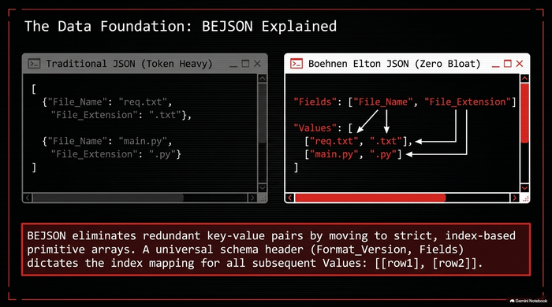
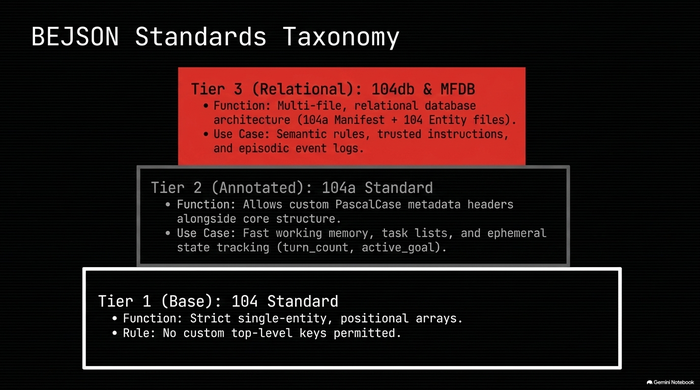
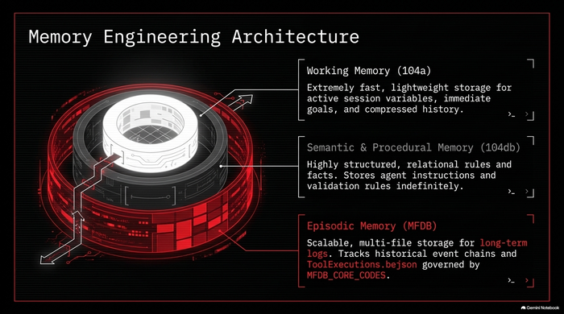
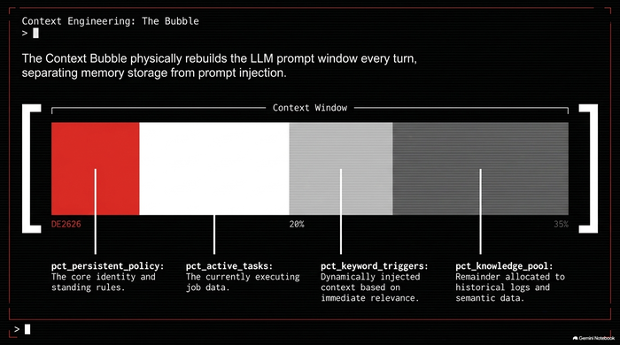
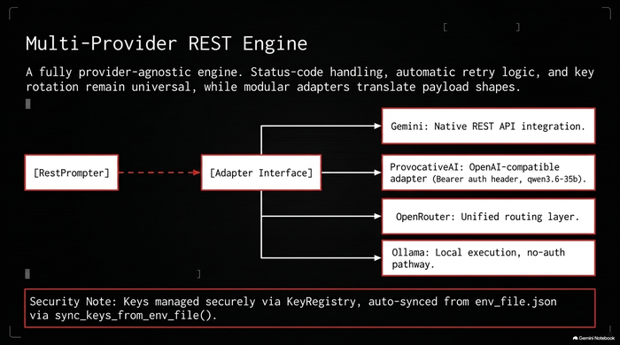

# NewAgent: Autonomous Multi-Provider Agentic AI Ecosystem & MFDB Framework

> **Ground-Up Asynchronous Agent Engine with Dual REST & Interactions Dispatch, Multi-File BEJSON Storage, Subagent Swarm Architecture, and Integrated CMS Tooling.**

---

## Table of Contents

- [1. Executive Summary & Vision](#1-executive-summary--vision)
- [2. Core Architectural Principles](#2-core-architectural-principles)
- [3. System Architecture & Component Topology](#3-system-architecture--component-topology)
- [4. Dual Inference Engine Architecture](#4-dual-inference-engine-architecture)
  - [4.1 REST API Prompter & Key Cooldown Engine](#41-rest-api-prompter--key-cooldown-engine)
  - [4.2 Native Tool-Calling & Interactions Engine](#42-native-tool-calling--interactions-engine)
- [5. Multi-Provider Ecosystem & API Support](#5-multi-provider-ecosystem--api-support)
  - [5.1 Google Gemini API Driver](#51-google-gemini-api-driver)
  - [5.2 Groq Accelerated API Driver](#52-groq-accelerated-api-driver)
  - [5.3 OpenRouter Multi-Model Gateway](#53-openrouter-multi-model-gateway)
  - [5.4 HuggingFace Inference API Driver](#54-huggingface-inference-api-driver)
- [6. Context Window & Context Bubble Management](#6-context-window--context-bubble-management)
  - [6.1 Dynamic Token Budget Allocation](#61-dynamic-token-budget-allocation)
  - [6.2 Keyword-Triggered Knowledge Pool Drip](#62-keyword-triggered-knowledge-pool-drip)
  - [6.3 Observer Compression & Amnesia Protocol](#63-observer-compression--amnesia-protocol)
- [7. Distributed Sub-Agent System](#7-distributed-sub-agent-system)
  - [7.1 Subagent Profiles & Lifecycle Management](#71-subagent-profiles--lifecycle-management)
  - [7.2 Inter-Agent Signaling & Session Resumption](#72-inter-agent-signaling--session-resumption)
  - [7.3 Subagent Administration CLI](#73-subagent-administration-cli)
- [8. Offline Job Planning & Task Tracking (JobMaker)](#8-offline-job-planning--task-tracking-jobmaker)
- [9. Data Layer: BEJSON 104a & MFDB Framework](#9-data-layer-bejson-104a--mfdb-framework)
  - [9.1 Field Map Cache & Positional Integrity](#91-field-map-cache--positional-integrity)
  - [9.2 MFDB Multi-File Database Persistence](#92-mfdb-multi-file-database-persistence)
  - [9.3 PID Locking & Resilient File IO](#93-pid-locking--resilient-file-io)


- [10. Integrated Suite of Subsystem Tools](#10-integrated-suite-of-subsystem-tools)
  - [10.1 NA-CMS (BEJSON-Backed CMS)](#101-na-cms-bejson-backed-cms)
  - [10.2 NA-WebToolkit (Headless Browser & Scraper)](#102-na-webtoolkit-headless-browser--scraper)
  - [10.3 NA-Chunker (Dataset & Archive Chunker)](#103-na-chunker-dataset--archive-chunker)
  - [10.4 NA-MD2HTML (Publication Compiler)](#104-na-md2html-publication-compiler)
  - [10.5 NA-Init (Workspace Bootstrapper)](#105-na-init-workspace-bootstrapper)
- [11. Interfaces & User Experience](#11-interfaces--user-experience)
  - [11.1 Web Terminal GUI (`webagent.py`)](#111-web-terminal-gui-webagentpy)
  - [11.2 Interactive CLI & TUI (`cliagent.py`)](#112-interactive-cli--tui-cliagentpy)
- [12. Slash Commands & Directive Engine](#12-slash-commands--directive-engine)
- [13. Environment Sourcing & Credential Security](#13-environment-sourcing--credential-security)
- [14. Directory Topology & Codebase Map](#14-directory-topology--codebase-map)
- [15. Verification, Audit & Quality Assurance](#15-verification-audit--quality-assurance)
- [16. Operations & Deployment Guide](#16-operations--deployment-guide)
- [17. Author & Maintainer Crediting](#17-author--maintainer-crediting)

---

## 1. Executive Summary & Vision

**NewAgent** represents a state-of-the-art, ground-up asynchronous agentic AI ecosystem engineered explicitly for high-throughput, local-first environments, Termux/Linux runtimes, and multi-model autonomous orchestration. Built upon strict data schema guarantees and modular Python 3.10+ primitives, NewAgent decouples model inference from local execution, enabling seamless integration across cloud API providers (Google Gemini, Groq, OpenRouter, HuggingFace) while preserving total local persistence via the BEJSON 104a and MFDB v1.31/v1.32 formats.

Unlike conventional single-loop LLM scripts, NewAgent features a dual-engine architecture capable of operating in both non-intrusive REST prompt/response mode and native XML/JSON tool-calling Interactions mode. It incorporates dynamic sliding context window budgeting, keyword-draped knowledge injection, resilient PID-locked session handling, sub-agent swarm management, and a comprehensive suite of integrated production tools including a full content management system (NA-CMS), web scraping toolkit (NA-WebToolkit), dataset chunker (NA-Chunker), and publication compiler (NA-MD2HTML).

Key Capabilities:
- Multi-provider API abstraction with automatic key rotation and rate-limit cooldown management.
- Dynamic Context Bubble context window budgeting and sliding token allocation.
- Hierarchical sub-agent swarm dispatch with profile isolation and inter-agent signaling.
- High-concurrency BEJSON 104a and Multi-File Database (MFDB) persistent data layer.
- Offline pre-planned job execution via JobMaker BEJSON checklists.
- Dual interface support providing both a web terminal GUI (`webagent.py`) and a TUI/CLI (`cliagent.py`).


---

## 2. Core Architectural Principles

NewAgent adheres strictly to a set of core engineering mandates designed to guarantee performance, maintainability, and data security:

1. **Zero Hardcoded Absolute Paths**: All file operations resolve dynamically through `$SCRIPT_PATH` relative navigation or canonical environment variable manifests (`/storage/emulated/0/.env/secure/secureenv_file.json` and `/storage/emulated/0/.env/user/paths.json`).
2. **BEJSON Positional Integrity & O(1) Field Map Caching**: Structural records are serialized in BEJSON 104a table format. Field resolution relies on runtime Field Map Caches to eliminate hardcoded positional indices and guarantee key-to-column mapping integrity even across schema evolution.
3. **Boundary-Layer Data Sanitization**: Input strings, dictionary keys, and raw payloads are stripped of whitespace and sanitized at boundary interfaces prior to caching or database insertion.
4. **Dual-Layer Environment Credential Isolation**: Sensitive API credentials, tokens, and SSH keys reside strictly in isolated secure storage locations and are never committed to source repositories.
5. **Resilient Multiprocess Lock Management**: High-concurrency operations utilize atomic file replacement (`.tmp` to final path via `mv`) and lockfiles managed by PID-aware guard modules (`lib_bejson_Core_bejson_path_guard.py`).
6. **Strict Logging & Error Transparency**: All error states are logged to standard Python `logging` infrastructure with explicit severity levels and stack traces, avoiding silent try/except swallows or unhandled crashes.

---

## 3. System Architecture & Component Topology

The architecture of NewAgent is organized into a modular, multi-tier hierarchy where entry points delegate processing to specialized libraries, extensions, and external toolkits.

```
+-----------------------------------------------------------------------+
|                         User Interfaces                               |
|   +-----------------------+               +-----------------------+   |
|   |  webagent.py (GUI)    |               |  cliagent.py (TUI)    |   |
|   +-----------+-----------+               +-----------+-----------+   |
+---------------+---------------------------------------+---------------+
                |                                       |
                v                                       v
+-----------------------------------------------------------------------+
|                    Core Orchestration Engine                          |


|                       agent.py (Main Dispatcher)                      |
+---------------+---------------------------------------+---------------+
                |                                       |
                v                                       v
+-------------------------------+       +-------------------------------+
|    REST API Engine            |       |    Interactions Engine        |
|  (lib_bejson_newagent_        |       |  (lib_bejson_newagent_        |
|      engine_rest.py)          |       |     engine_interactions.py)   |
+---------------+---------------+       +---------------+---------------+
                |                                       |
                +-------------------+-------------------+
                                    |
                                    v
+-----------------------------------------------------------------------+
|                   Context Bubble & Memory Pipeline                    |
|             (lib_bejson_newagent_context_bubble.py)                   |
|   - Budget Allocator   - Knowledge Drip   - Observer Compression      |
+-----------------------------------+-----------------------------------+
                                    |
                                    v
+-----------------------------------------------------------------------+
|                    Subagent & Swarm Manager                           |
|      (subagent_admin.py & lib_bejson_newagent_subagent_*.py)          |
+-----------------------------------+-----------------------------------+
                                    |
                                    v
+-----------------------------------------------------------------------+
|                   Action Execution & Tool Dispatch                    |
|              (lib_bejson_newagent_actions.py)                         |
|   - File System   - Ripgrep Search   - Bash Exec   - Web Scraper      |
+-----------------------------------+-----------------------------------+


                                    |
                                    v
+-----------------------------------------------------------------------+
|                  BEJSON 104a & MFDB Storage Layer                     |
|           (lib_bejson_Core_bejson_core.py & mfdb_core.py)             |
+-----------------------------------------------------------------------+
```

---

## 4. Dual Inference Engine Architecture

NewAgent features a hybrid inference engine capable of switching dynamically between two distinct execution models depending on user preference and model capabilities.

### 4.1 REST API Prompter & Key Cooldown Engine
The REST engine (`lib/lib_bejson_newagent_engine_rest.py`) manages direct HTTP/REST communication across registered LLM providers:

- **Automated Key Rotation**: Maintains an active registry of API keys sourced from secure environment stores (`secureenv_file.json`). Keys are selected round-robin or based on availability metrics.
- **Provider Cooldown Tracking**: Implements per-key and per-model cooldown timers (`config/key_state.bejson`). When a provider returns HTTP 429 rate limits or quota exceptions, the key is automatically placed on cooldown and alternate keys are selected without interrupting user sessions.
- **Model Catalog Registry**: Dynamically discovers and caches available models (`config/gemini_catalog.bejson` and `config/models.bejson`), tracking context window bounds and vision features.

### 4.2 Native Tool-Calling & Interactions Engine
The Interactions engine (`lib/lib_bejson_newagent_engine_interactions.py`) provides structured tool invocation:

- **XML Tag Action Parsing**: Intercepts structured action tags embedded in model responses (e.g., `<exec>`, `<read_file>`, `<write_file>`, `<search_text>`, `<subagent_dispatch>`).
- **Atomic Dispatch Queue**: Validates action parameters against path-guard safety rules before executing operations sequentially.
- **Multi-Turn Feedback Loops**: Captures execution stdout, stderr, and exit codes, feeding them back into the model's conversation transcript for interactive step-by-step execution.

---

## 5. Multi-Provider Ecosystem & API Support




NewAgent abstracts model API differences behind unified driver interfaces located in `lib_extensions/`.

### 5.1 Google Gemini API Driver
- **Module**: `lib_extensions/lib_bejson_AI_bejson_interactions.py`
- **Capabilities**: Supports Gemini 1.5 Pro, Gemini 1.5 Flash, Gemini 2.0 Flash, and multimodal models. Implements structured JSON outputs and system prompt conditioning.

### 5.2 Groq Accelerated API Driver
- **Module**: `lib_extensions/lib_bejson_AI_bejson_groq.py`
- **Capabilities**: Ultra-low-latency inference driver utilizing Llama 3, Mixtral, and DeepSeek models hosted on Groq LPU hardware. Ideal for fast keyword extraction and subagent evaluation tasks.

### 5.3 OpenRouter Multi-Model Gateway
- **Module**: `lib_extensions/lib_bejson_AI_bejson_openrouter.py`
- **Capabilities**: Universal fallback gateway routing requests across open-source and proprietary models (Claude 3.5 Sonnet, GPT-4o, Qwen 2.5, DeepSeek V3/R1).

### 5.4 HuggingFace Inference API Driver
- **Module**: `lib_extensions/lib_bejson_AI_bejson_huggingface.py`
- **Capabilities**: Direct integration with HuggingFace Serverless Inference endpoints for open models, custom domain fine-tunes, and embeddings.

---

## 6. Context Window & Context Bubble Management

To maintain long-running agent conversations without exceeding model context limits or consuming excessive tokens, NewAgent implements the **Context Bubble System** (`lib/lib_bejson_newagent_context_bubble.py`).

### 6.1 Dynamic Token Budget Allocation
The Context Bubble calculates prompt context allocations dynamically:

- **Percentage-Based Partitioning**: Total token space is split into fixed percentage budgets reserved for core system instructions, active session history, environment drips, job status, and keyword knowledge payloads.
- **Sliding History Window**: Conversation transcripts are pruned automatically using sliding window token counting, preserving system instructions and recent turns.




### 6.2 Keyword-Triggered Knowledge Pool Drip
The system continuously monitors incoming user prompts for pre-configured keyword triggers (`config/triggers.bejson`):

- **Targeted Knowledge Retrieval**: Matching keywords pull indexed knowledge blocks (`kb://...`) from `config/knowledge_pool.bejson` and inject them directly into the context bubble.
- **Cooldown Enforcement**: Each trigger entry carries a cooldown period (e.g., 600s) to prevent repetitive injections of identical documentation across consecutive turns.

### 6.3 Observer Compression & Amnesia Protocol
When context size approaches total model limits:

- **Observer Summarizer**: An observer pass distills older transcript turns into compact bulleted summaries while preserving key variables and technical decisions.
- **Job-Scoped Amnesia**: Upon job switching or session reset, task-specific transient context is purged while fundamental system knowledge is retained.

---

## 7. Distributed Sub-Agent System

NewAgent supports hierarchical multi-agent execution, allowing a primary agent to spawn, supervise, and communicate with specialized subagents.

```
+-----------------------------------------------------------------------+
|                            Primary Agent                              |
+-----------------------------------+-----------------------------------+
                                    | Spawns / Supervises
                                    v
+-----------------------------------------------------------------------+
|                       Subagent Administrator                          |
|             (subagent_admin.py & runtime extensions)                  |
+---------+-------------------------+-------------------------+---------+
          |                         |                         |
          v                         v                         v
+-------------------+     +-------------------+     +-------------------+



|  Research Agent   |     |  Code Refactor    |     |   CMS Publisher   |
|   (Read-Only)     |     |   (Subagent 2)    |     |   (Subagent 3)    |
+-------------------+     +-------------------+     +-------------------+
```

### 7.1 Subagent Profiles & Lifecycle Management
- **Profile Declarations**: Managed via `lib_bejson_newagent_subagent_profiles.py`, subagents inherit specific tool access levels (e.g., read-only filesystem, full bash execution, CMS publishing).
- **Runtime Sandboxing**: Subagent execution environments isolate context windows, session logs, and key selection to prevent state contamination of the primary agent.

### 7.2 Inter-Agent Signaling & Session Resumption
- **Signal Bus**: Subagents communicate back to the primary agent via signal files (`lib_bejson_newagent_subagent_signals.py`).
- **Session Persistence**: Active subagent states are saved in `.104db.bejson` format (`lib_bejson_newagent_subagent_sessions.py`), allowing suspended subagents to resume seamlessly across system restarts.

### 7.3 Subagent Administration CLI
The standalone utility `subagent_admin.py` provides manual oversight:

```bash
# List all registered subagent profiles
python3 subagent_admin.py --list-profiles

# Dispatch a specific subagent with a target task
python3 subagent_admin.py --dispatch --profile research --prompt "Audit security in lib_bejson_Core_path_guard.py"
```

---

## 8. Offline Job Planning & Task Tracking (JobMaker)

`JobMaker.py` provides a dedicated GUI and backend engine for pre-planning multi-step engineering workflows.

- **BEJSON 104a Job Schema**: Jobs are structured datasets stored in `jobs/` containing primary goals, acceptance criteria, and ordered atomic tasks.



- **State Preservation**: Tracks task statuses (`PENDING`, `IN_PROGRESS`, `COMPLETED`, `FAILED`) and preserves output context from completed steps to feed into subsequent subtasks.
- **Integration with Main Agent**: At startup, `agent.py` scans `jobs/` via `lib_bejson_newagent_jobs.py` and allows users to trigger automated job execution via the `/jobstart` directive.

---

## 9. Data Layer: BEJSON 104a & MFDB Framework

All persistent data within NewAgent is managed by the custom BEJSON (Binary-Equivalent JSON) 104a standard and Multi-File Database (MFDB v1.31/v1.32) orchestrator.

### 9.1 Field Map Cache & Positional Integrity
BEJSON stores data in tabular array format with explicit field header declarations. To ensure $O(1)$ attribute lookups and guard against schema drift:

- **Field Map Caching**: Every record operation generates a dynamic field index mapping (`FieldMapCache`), eliminating hardcoded positional offsets.
- **Backward Compatibility**: New fields append strictly to the end of schema declarations, guaranteeing legacy dataset readability without breaking existing code paths.

### 9.2 MFDB Multi-File Database Persistence
Complex entity networks (such as CMS content, session histories, and key registries) utilize the MFDB engine (`lib/lib_bejson_Core_mfdb_core.py`):

- **Master Manifests**: Unified `104a.mfdb.bejson` manifests map entity tables, foreign keys, and write-ownership modules.
- **Meta-Debug Audit Log**: When enabled, every write operation logs field modifications, execution times, PID, and success statuses to dedicated meta-debug entities.

### 9.3 PID Locking & Resilient File IO
- **Atomic File Writing**: File updates write to a temporary file (`.tmp`) before performing an atomic filesystem rename, preventing file corruption during power failures or Termux crashes.
- **Path Guard Protection**: `lib_bejson_Core_bejson_path_guard.py` enforces canonical path safety, preventing directory traversal vulnerabilities.

---

## 10. Integrated Suite of Subsystem Tools

NewAgent ships with a suite of built-in production toolkits located in `tools/`.




### 10.1 NA-CMS (BEJSON-Backed CMS)
- **Directory**: `tools/NA-CMS/`
- **Description**: Enterprise-grade content management system running on top of BEJSON/MFDB storage. Includes automated web renderers, media handlers, draft managers, and administrative web interfaces (`NewAgent_CMS_System.py`).

### 10.2 NA-WebToolkit (Headless Browser & Scraper)
- **Directory**: `tools/NA-WebToolkit/`
- **Description**: Complete web extraction and search engine wrapper (`Cli_Web_Toolkit.py`). Uses headless extraction (`web_extractor_core.py`) and browser automation (`browser_core.py`) to fetch web content and feed clean markdown into NewAgent context windows.

### 10.3 NA-Chunker (Dataset & Archive Chunker)
- **Directory**: `tools/NA-Chunker/`
- **Description**: Utility (`CLI_Chunker.py`) for chunking, packaging, and mounting large project codebases and datasets into Canonical Chunked-104a BEJSON archives.

### 10.4 NA-MD2HTML (Publication Compiler)
- **Directory**: `tools/NA-MD2HTML/`
- **Description**: Markdown to standalone editorial HTML publication builder (`MD_To_HTML.py`). Renders styled articles, technical guides, and documentation using the classic publication layout.

### 10.5 NA-Init (Workspace Bootstrapper)
- **Directory**: `tools/NA-Init/`
- **Description**: Automated workspace setup utility (`CLI_Init.py`) that initializes directory hierarchies, validates environment variable stores, and sets up BEJSON project manifests.

---

## 11. Interfaces & User Experience

NewAgent provides flexible user interfaces tailored for both graphical browser environments and terminal command-line operations.

### 11.1 Web Terminal GUI (`webagent.py`)
- **Framework**: Micro Flask web server serving an embedded single-page web terminal interface.
- **Features**: Live command output streaming, quickjump navigation bars, model selection drop-downs, real-time key status monitoring, and integrated system diagnostics.

### 11.2 Interactive CLI & TUI (`cliagent.py`)


- **Framework**: Pure Python terminal interface equipped with ANSI color palettes, rich progress bars, and keyboard shortcuts.
- **Features**: Direct prompt execution, non-interactive piping (`cat prompt.txt | python3 cliagent.py`), and job status monitoring.

---

## 12. Slash Commands & Directive Engine

NewAgent includes an extensible slash-command parser (`lib/lib_bejson_newagent_commands.py`) allowing users to issue high-level operational directives directly in chat mode:

| Slash Command | Description |
| :--- | :--- |
| `/goal <text>` | Defines a top-level persistent goal for long-running autonomous execution loops. |
| `/jobstart <job>` | Instantiates and begins executing a saved JobMaker BEJSON checklist. |
| `/plan <task>` | Instructs the agent to perform step-by-step pre-planning before making changes. |
| `/grill-me` | Triggers interactive interview mode to clarify underspecified requirements. |
| `/schedule <cron>` | Schedules background tasks or recurring automated checks. |
| `/reset` | Wipes transient session context while maintaining persistent system directives. |
| `/status` | Displays live API key cooldown states, model availability, and token budget usage. |

---

## 13. Environment Sourcing & Credential Security

NewAgent implements a dual-store environment variable architecture to separate sensitive API credentials from user environment paths:

- **Secure Credentials Store**: `/storage/emulated/0/.env/secure/secureenv_file.json` (Stores `GEMINI_KEY_*`, `GROQ_KEY_*`, `OPENROUTER_KEY_*`, `GITHUB_TOKEN`, etc.)
- **User Non-Sensitive Paths Store**: `/storage/emulated/0/.env/user/paths.json` (Stores `INTERNAL_STORAGE`, `SD_CARD`, `ADMIN`, `PROJECT_ROOT`, etc.)

Templates for initializing new environments are provided in `env_templates/`:
- `env_templates/secureenv_file.template.json`
- `env_templates/paths.template.json`


---

## 14. Directory Topology & Codebase Map

```
NewAgent/
├── agent.py                      # Main async event loop & model orchestrator
├── webagent.py                   # Flask Web Terminal GUI interface
├── cliagent.py                   # Interactive CLI / TUI interface
├── subagent_admin.py             # Subagent manager & dispatch utility
├── JobMaker.py                   # Offline BEJSON job creation GUI & planner
├── .bejson_project.json          # Root BEJSON 104a project manifest & changelog
├── AUDIT.md                      # Codebase security & architectural audit log
├── requirements.txt              # Package dependencies
├── Context/                      # Context bubble directives & persistent policies
│   ├── Context_Bubble.md
│   ├── Persistent_Policy.md
│   └── Situational_Awareness/
├── config/                       # BEJSON configuration & state stores
│   ├── config.json
│   ├── constant_config.bejson
│   ├── gemini_catalog.bejson
│   ├── key_state.bejson
│   ├── keys.bejson
│   ├── knowledge_pool.bejson
│   ├── models.bejson
│   └── triggers.bejson
├── dev/                          # Developer tracking & atomic job checklists
│   ├── change-log.md
│   ├── checklist-*.md


│   ├── dead_code.md
│   └── security-notes.md
├── docs/                         # Technical documentation & architecture specs
│   └── technical_overview.md
├── env_templates/                # Pre-populated environment schema templates
├── images/                       # System architecture slide diagrams (Slide 1..15)
├── jobs/                         # Saved BEJSON 104a job checklists
├── lib/                          # Core engine libraries (NewAgent & BEJSON Core)
│   ├── lib_bejson_Core_bejson_core.py
│   ├── lib_bejson_Core_mfdb_core.py
│   ├── lib_bejson_newagent_actions.py
│   ├── lib_bejson_newagent_context_bubble.py
│   ├── lib_bejson_newagent_engine_interactions.py
│   ├── lib_bejson_newagent_engine_rest.py
│   └── lib_bejson_newagent_session.py
├── lib_extensions/               # Multi-provider AI drivers (Gemini, Groq, HF, OpenRouter)
├── logs/                         # Session transcripts & raw API debug logs
├── tests/                        # Pytest suite for core engine & MFDB verification
└── tools/                        # Integrated subsystem toolkits
    ├── NA-CMS/                   # BEJSON Content Management System
    ├── NA-Chunker/               # Codebase & dataset chunker tool
    ├── NA-Init/                  # Workspace bootstrapper
    ├── NA-MD2HTML/               # Markdown-to-HTML publication compiler
    └── NA-WebToolkit/            # Web scraper & browser extraction toolkit
```

---

## 15. Verification, Audit & Quality Assurance

NewAgent undergoes automated unit and integration testing via `pytest`. The test suite covers key system behaviors including:


- Multi-provider REST engine key rotation and cooldown management (`tests/test_engine_rest_key_rotation.py`).
- Ripgrep output capping and search boundary bounds (`tests/test_actions_search_text_cap.py`).
- Resilient multiprocess PID locking (`tests/test_locking_resilient_pid.py`).
- MFDB table validation and field map cache consistency (`tests/test_mfdb_core_write_checks.py`).
- Subagent history budget allocations (`tests/test_subagent_history_budget.py`).

Run the complete test suite:
```bash
pytest tests/
```

---

## 16. Operations & Deployment Guide

### Prerequisites
- Python 3.10+ runtime environment.
- Linux / Termux or macOS host filesystem.
- Git & GitHub CLI (`gh`) configured with appropriate credentials.

### Installation & Launch Steps

1. Clone the repository:
```bash
git clone git@github.com:boehnenelton/NewAgent.git
cd NewAgent
```

2. Install dependencies:
```bash


pip install -r requirements.txt
```

3. Configure environment variables using templates:
```bash
cp env_templates/secureenv_file.template.json /storage/emulated/0/.env/secure/secureenv_file.json
cp env_templates/paths.template.json /storage/emulated/0/.env/user/paths.json
```

4. Launch NewAgent:
- **CLI Interactive Mode**:
  ```bash
  python3 cliagent.py
  ```
- **Web Terminal GUI**:
  ```bash
  python3 webagent.py
  ```
- **Subagent Administration**:
  ```bash
  python3 subagent_admin.py --list-profiles
  ```

---

## 17. Author & Maintainer Crediting

**Author & Creator**: Elton Boehnen  
**Email**: boehnenelton2024@gmail.com / eltonboehnen@gmail.com  
**Website**: [boehnenelton2024.pages.dev](https://boehnenelton2024.pages.dev)  
**GitHub**: [github.com/boehnenelton](https://github.com/boehnenelton)  


---
*Built with precision for high-performance autonomous agent orchestration and BEJSON multi-file storage architecture.*