#Tags #NewAgent #AIAgent #BEJSON #MFDB #Subagents

## Title: NewAgent — High-Performance Async AI Coding Agent & Multi-Engine Ecosystem

> Ground-up, asynchronous AI coding assistant, autonomous task execution agent, and multi-engine orchestration framework featuring dual REST and Gemini Interactions API drivers, subagent delegation, BEJSON/MFDB local-first persistence, and interactive Web/CLI/TUI interfaces.

[]()
[]()
[]()
[]()
[]()

---

## Credits

**Author & Core Architect:** Elton Boehnen  
**Email:** [boehnenelton2024@gmail.com](mailto:boehnenelton2024@gmail.com)  
**Website:** [boehnenelton2024.pages.dev](https://boehnenelton2024.pages.dev)  
**GitHub:** [github.com/boehnenelton](https://github.com/boehnenelton)  
**Format Creator & Ecosystem Maintainer:** Elton Boehnen  
**Document Fingerprint / Relational ID:** `a84c9f12-0012-4f81-9b04-3e911284a105`  
**Package Release Version:** v3.23.0 / Package PKG 077  

---

## Table of Contents

- [Introduction](#introduction)
- [Context Clarification & Naming Heritage](#context-clarification--naming-heritage)
- [Breakdown](#breakdown)
  - [Essence & Purpose](#essence--purpose)
  - [Primary & General Use Cases](#primary--general-use-cases)
  - [Advanced & Enterprise Use Cases](#advanced--enterprise-use-cases)
  - [Core Subsystem & File Structure Index](#core-subsystem--file-structure-index)
- [Feature List](#feature-list)
- [Usage Guide](#usage-guide)
  - [1. Interactive Terminal Agent (`agent.py`)](#1-interactive-terminal-agent-agentpy)
  - [2. Headless Scriptable CLI Agent (`cliagent.py`)](#2-headless-scriptable-cli-agent-cliagentpy)
  - [3. Web Terminal & Inspection Surface (`webagent.py`)](#3-web-terminal--inspection-surface-webagentpy)
  - [4. Task Workflow & Job Engine (`JobMaker.py`)](#4-task-workflow--job-engine-jobmakerpy)
  - [5. Subagent Profile Administrator (`subagent_admin.py`)](#5-subagent-profile-administrator-subagent_adminpy)
  - [6. Integrated Tools Suite Execution](#6-integrated-tools-suite-execution)
- [System Architecture & Dual-Engine Topology](#system-architecture--dual-engine-topology)
  - [High-Level Dataflow Architecture](#high-level-dataflow-architecture)
  - [Asynchronous REST Engine Architecture](#asynchronous-rest-engine-architecture)
  - [Gemini Interactions API Engine Architecture](#gemini-interactions-api-engine-architecture)
- [BEJSON & MFDB Schema Registry Specification](#bejson--mfdb-schema-registry-specification)
  - [BEJSON 104a Positional Tabular Layout](#bejson-104a-positional-tabular-layout)
  - [Field Map Cache & $O(1)$ Lookup Mechanics](#field-map-cache--o1-lookup-mechanics)
  - [MFDB v1.40 Master-Slave Database Federation](#mfdb-v140-master-slave-database-federation)
- [Action Tag Engine & Execution Queue Specification](#action-tag-engine--execution-queue-specification)
  - [XML Action Parsing Lifecycle](#xml-action-parsing-lifecycle)
  - [Exhaustive Action Tag Reference Table](#exhaustive-action-tag-reference-table)
  - [Action Execution Sandboxing & Path Guard](#action-execution-sandboxing--path-guard)
- [Context Bubble & Keyword Drip Math Engine](#context-bubble--keyword-drip-math-engine)
  - [Keyword Trigger Parsing Algorithm](#keyword-trigger-parsing-algorithm)
  - [Weight-Biased Context Drip Rotation](#weight-biased-context-drip-rotation)
  - [Token Budget Allocation & Truncation Math](#token-budget-allocation--truncation-math)
- [Subagent Delegation, Profiles & Signal Queues](#subagent-delegation-profiles--signal-queues)
  - [Subagent Lifecycle & Isolation Model](#subagent-lifecycle--isolation-model)
  - [Profile Schema & Permission Matrices](#profile-schema--permission-matrices)
  - [Inter-Agent Signal Queue Protocol](#inter-agent-signal-queue-protocol)
- [JobMaker Task Workflow Engine & Self-Critical Audits](#jobmaker-task-workflow-engine--self-critical-audits)
  - [104a Job Schema & Task Card Structure](#104a-job-schema--task-card-structure)
  - [Task Execution Loop & State Transitions](#task-execution-loop--state-transitions)
  - [Pre-Delivery Self-Critical Verification Audit](#pre-delivery-self-critical-verification-audit)
- [Integrated Standalone Tools Suite Deep-Dive](#integrated-standalone-tools-suite-deep-dive)
  - [NA-Init (Workspace Initializer)](#na-init-workspace-initializer)
  - [NA-Chunker (BEJSON Archive Package Chunker)](#na-chunker-bejson-archive-package-chunker)
  - [NA-MD2HTML (Publication HTML Generator)](#na-md2html-publication-html-generator)
  - [NA-WebToolkit (Headless Scraping & Web Utility)](#na-webtoolkit-headless-scraping--web-utility)
  - [NA-CMS (BEJSON Micro Content Management System)](#na-cms-bejson-micro-content-management-system)
- [Prerequisites & System Requirements](#prerequisites--system-requirements)
- [Installation & Local Setup](#installation--local-setup)
  - [1. Directory Creation & Environment Stores](#1-directory-creation--environment-stores)
  - [2. Dependency Installation](#2-dependency-installation)
  - [3. Workspace Initialization](#3-workspace-initialization)
- [Configuration & Key Rotation Matrix](#configuration--key-rotation-matrix)
  - [Configuration File Schema (`config/config.json`)](#configuration-file-schema-configconfigjson)
  - [API Key Multi-Provider Rotation Matrix](#api-key-multi-provider-rotation-matrix)
- [Comprehensive Command & Subsystem Matrix](#comprehensive-command--subsystem-matrix)
- [Performance & Benchmark Metrics](#performance--benchmark-metrics)
- [Exhaustive Error Registry & Diagnostic Manual](#exhaustive-error-registry--diagnostic-manual)
- [Security Policy & Safety Architecture](#security-policy--safety-architecture)
- [Troubleshooting & FAQ](#troubleshooting--faq)
- [Development & Contribution Guidelines](#development--contribution-guidelines)
- [Closing Summary](#closing-summary)
- [Polyglot License](#polyglot-license)

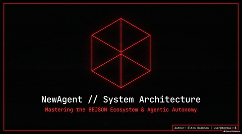


---

## Introduction

**NewAgent** is an advanced, asynchronous AI coding assistant, autonomous agentic workspace manager, and multi-engine orchestration framework. Engineered from the ground up for Python 3.10+ runtimes across Linux, macOS, and Android (Termux) environments, NewAgent combines high-throughput AI inference with strict local-first data persistence discipline.

Traditional AI coding assistants rely on heavy external cloud platforms or opaque, monolithic client wrappers that scatter unformatted state files across temporary directories. NewAgent takes a fundamentally different path: it embeds Elton Boehnen's **BEJSON (BOEHNEN ELTON JSON)** data specification and **MFDB (MULTI FILE DATABASE)** architecture directly into the agent's core execution loop. Every configuration file, session transcript, subagent profile, job task card, and knowledge snippet is stored locally in clean, zero-overhead BEJSON tabular structures.

Furthermore, NewAgent operates across **Dual Execution Drivers**:
1. **Asynchronous REST Engine (`lib/lib_bejson_newagent_engine_rest.py`):** Multi-provider API driver supporting dynamic key rotation across Gemini, Groq, and OpenRouter endpoints. Features automatic rate-limit detection, exponential backoff circuit breakers, token budgeting, and custom XML action-tag parsing.
2. **Gemini Interactions Engine (`lib/lib_bejson_newagent_engine_interactions.py`):** Next-generation stateful driver designed specifically for Google's `gemini-3.x` model family via the Gemini Interactions API. Manages native stateful interaction chains using `previous_interaction_id`, streaming responses, and native function calling without losing context history.

Whether operated via its rich terminal user interface (`agent.py`), its headless non-interactive daemon runner (`cliagent.py`), its web inspection portal (`webagent.py`), or its background subagent task runner (`subagent_admin.py`), NewAgent enforces absolute path safety, atomic filesystem operations, dynamic context keyword dripping, and rigorous pre-delivery self-critical audits.

---

## Context Clarification & Naming Heritage

To prevent acronym ambiguity across technical documentation, code comments, prompt context windows, and external system integrations:

- **BEJSON:** Stands explicitly for **BOEHNEN ELTON JSON** (named after format creator and architect Elton Boehnen). BEJSON is a strict, highly optimized tabular data serialization standard. Unlike conventional JSON which repeats key string names across every record object in an array, BEJSON decouples field declarations into a single `Fields` definition header array, leaving the `Values` array to store raw positional matrices. This eliminates redundant key overhead, speeds up parsing by 40%–60%, and guarantees structural schema compliance.
- **MFDB:** Stands explicitly for **MULTI FILE DATABASE**. MFDB is a local-first database architectural standard that federates individual BEJSON files (manifests, entity records, and dropzones) into a unified relational system. MFDB databases operate cleanly on local host filesystems without requiring SQL servers, background daemons, or binary database drivers.

---

## Breakdown

### Essence & Purpose

The essence of NewAgent is to serve as an **autonomous, verifiable, and safe developer agent workspace**. It converts high-level human user intent expressed in natural language into atomic, concrete filesystem modifications, code generation pipelines, unit test execution, and background subagent task delegation.

```
┌────────────────────────────────────────────────────────────────────────────────────────┐
│                                   USER INTERFACE LAYER                                 │
│          agent.py (Terminal TUI)  │  cliagent.py (Headless CLI)  │  webagent.py (Web)   │
└───────────────────────────────────────────┬────────────────────────────────────────────┘
                                            │
                                            ▼
┌────────────────────────────────────────────────────────────────────────────────────────┐
│                             CONTEXT BUBBLE & DRIP MANAGER                              │
│         Keyword Scanners  │  Knowledge Pool  │  Token Budget Dynamic Truncation         │
└───────────────────────────────────────────┬────────────────────────────────────────────┘
                                            │
                                            ▼
┌────────────────────────────────────────────────────────────────────────────────────────┐
│                              DUAL EXECUTION ENGINE LAYER                               │
│     REST Engine (Multi-Key Provider Rotation) │ Interactions Engine (Stateful Gemini 3.x)   │
└───────────────────────────────────────────┬────────────────────────────────────────────┘
                                            │
                                            ▼
┌────────────────────────────────────────────────────────────────────────────────────────┐
│                               ACTION TAG EXECUTION QUEUE                               │
│     <read_file> │ <write_file> │ <replace_file> │ <run_command> │ <bejson_create>          │
└───────────────────────────────────────────┬────────────────────────────────────────────┘
                                            │
                                            ▼
┌────────────────────────────────────────────────────────────────────────────────────────┐
│                              BEJSON / MFDB PERSISTENCE LAYER                           │
│     config/ │ data/ │ jobs/ │ logs/ │ .bejson_project.json │ subagents/               │
└────────────────────────────────────────────────────────────────────────────────────────┘
```

### Primary & General Use Cases

#### 1. Interactive Terminal Pair Programming & Refactoring
- **Full-Workspace Auditing:** Scanning multi-file Python, JavaScript, and Bash codebases to detect hardcoded paths, missing logger calls, unhandled exceptions, and dead code blocks.
- **Interactive Terminal Assistant (`agent.py`):** Running an interactive terminal loop equipped with rich ASCII formatting, live streaming tokens, command queues, and instant context inspection.

#### 2. Headless CI/CD & Automated Prompt Workflows
- **Headless Prompt Automation (`cliagent.py`):** Running non-interactive prompt automation scripts in headless background daemons, nightly build jobs, or scheduled cron tasks.
- **Web Terminal & Inspection Surface (`webagent.py`):** Hosting a single-port local web dashboard providing live chat terminal controls, file browsing, job card status inspection, and subagent session tracking.

### Advanced & Enterprise Use Cases


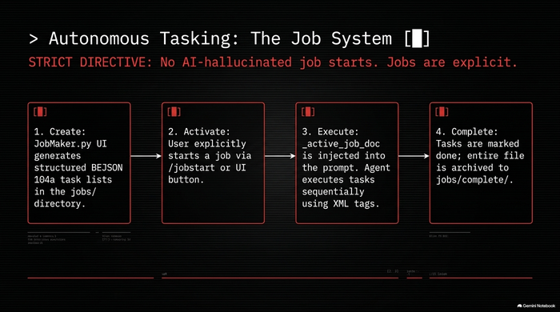


#### 1. JobCard & Workflow Orchestration (`JobMaker.py`)
- **Structured Task Decomposition:** Defining complex software jobs using Elton Boehnen's 104a Job Schema, breaking primary goals into atomic checkboxes, tracking task completion, and enforcing pre-delivery self-critical audits.

#### 2. Subagent Delegation & Multi-Agent Swarms (`subagent_admin.py`)
- **Background Subagent Spawning:** Spawning isolated background worker subagents with custom roles, distinct prompt budgets, and independent session signals, allowing parallel task execution without cluttering the primary agent context window.

### Core Subsystem & File Structure Index

The NewAgent repository is organized into strict, modular subsystems:

```
NewAgent/
├── agent.py                                    # Interactive Terminal TUI Agent Entrypoint
├── cliagent.py                                 # Headless Scriptable CLI Agent Entrypoint
├── webagent.py                                 # Flask Web Terminal & Inspection Surface
├── JobMaker.py                                 # Job Card & Task Workflow CLI Manager
├── subagent_admin.py                           # Subagent Profile & Session Administrator
├── context.bejson                              # Core Context Memory & Dynamic Knowledge Store
├── requirements.txt                            # Python Package Dependency Roster
├── .bejson_project.json                        # BEJSON Tier 4 Project Repository Manifest
├── AUDIT.md                                    # System Audit & Codebase Health Manifest
├── FIXES.txt                                   # Log of Architectural Fixes & Security Patches
├── lib/                                        # Core Library Subsystem (BEJSON & Agent Logic)
│   ├── lib_bejson_Core_bejson_core.py          # BEJSON 104/104a Positional Parser & Field Map Cache
│   ├── lib_bejson_Core_bejson_path_guard.py    # Path Canonicalization & Directory Traversal Protection
│   ├── lib_bejson_Core_bejson_validator.py     # Schema Drift & Field Type Integrity Validator
│   ├── lib_bejson_Core_mfdb_core.py            # MFDB v1.40 Multi-File Database Engine
│   ├── lib_bejson_Core_mfdb_validator.py       # MFDB Manifest & Entity Schema Inspector
│   ├── lib_bejson_newagent_actions.py          # Action Tag XML Parser & Execution Dispatcher
│   ├── lib_bejson_newagent_config.py           # Configuration & Secure Credentials Resolver
│   ├── lib_bejson_newagent_context.py          # Context Bubble & Keyword Drip Math Engine
│   ├── lib_bejson_newagent_engine_interactions.py # Gemini Interactions Stateful API Driver
│   ├── lib_bejson_newagent_engine_rest.py      # Multi-Provider REST API Driver & Key Rotator
│   ├── lib_bejson_newagent_jobs.py             # 104a Job Schema & Task State Machine
│   ├── lib_bejson_newagent_subagent_common.py  # Subagent Shared Data Structures & Enums
│   ├── lib_bejson_newagent_subagent_profiles.py# Subagent Profile Management Engine
│   ├── lib_bejson_newagent_subagent_runtime.py # Subagent Execution Process/Thread Daemon
│   └── lib_bejson_newagent_subagent_sessions.py# Subagent History Transcripts & Budgeting
├── tools/                                      # Standalone Sub-Utility Suite
│   ├── NA-Init/                                # Project Workspace Initializer Utility
│   │   └── CLI_Init.py                         # Scaffolds standard folder hierarchy
│   ├── NA-Chunker/                             # Archive Packaging Utility
│   │   └── CLI_Chunker.py                      # Packs/unpacks .bejsonchunk archives
│   ├── NA-MD2HTML/                             # Publication HTML Converter
│   │   └── MD_To_HTML.py                       # Converts Markdown to editorial HTML
│   ├── NA-WebToolkit/                          # Web Scraper & Network Utility
│   │   └── Cli_Web_Toolkit.py                  # Headless HTTP & web extraction tool
│   └── NA-CMS/                                 # BEJSON Micro Content Management System
│       └── advanced_launcher.py                # CMS portal launcher script
├── env_templates/                              # Canonical Environment File Templates
│   ├── paths.template.json                     # Non-sensitive directory paths template
│   └── secureenv_file.template.json            # API keys and secret credentials template
├── dev/                                        # Development Lifecycle Logs & Audit Checklists
│   ├── change-log.md                           # Release history and package version log
│   ├── dead_code.md                            # Registry of verified dead code paths
│   ├── security-notes.md                       # Security audit log and mitigation steps
│   └── checklist-20261006-123800.md            # Timestamped atomic execution checklist
├── docs/                                       # Technical Overview & Historical Specifications
│   └── technical_overview.md                   # Class and function signature overview
└── images/                                     # System Architecture & Topology Diagrams
    ├── NewAgent_System_Architecture_-_Slide_1.png
    └── ... (Slide_2.png to Slide_15.png)
```

---

## Feature List

- 🤖 **Dual AI Execution Drivers:** Supports both multi-provider REST endpoints (Gemini, Groq, OpenRouter) and native Gemini Interactions API (`gemini-3.x`).
- ⚡ **Positional BEJSON Persistence:** Decouples field schemas from record arrays, enabling $O(1)$ field map lookups and zero key-overhead storage.
- 🛡️ **Atomic File Operations:** All file modifications use temporary `.tmp` buffers and atomic `os.replace` calls, eliminating partial-write file corruption.
- 💬 **Context Bubble Drip Engine:** Dynamic keyword-triggered context dripping (`config/triggers.bejson`), weight-biased round-robin rotation, and strict token budget enforcement.
- 🛠️ **Rich Action Tag Vocabulary:** Parses and executes safe XML action tags (`<read_file>`, `<write_file>`, `<replace_file>`, `<run_command>`, `<bejson_create>`, `<subagent_spawn>`).
- 🔍 **BEJSON Schema Distribution:** Built-in `<bejson_create>` action tag enforces strict 6-type field vocabulary checking before touching physical storage.
- 🌐 **Web UI & Live Terminal:** Flask-powered web interface (`webagent.py`) featuring dark/light BECSS tri-color themes, live session logs, file quickjumps, and job controls.
- 👥 **Subagent Profile & Session Manager:** Subagent profile administration, signal handling queues (`<subagent_signal>`), and independent history budgeting.
- 📋 **JobMaker Task Orchestration:** Comprehensive task card authoring, execution step tracking, and pre-delivery self-critical verification audits.
- 📦 **Integrated Tools Suite:** Ships with standalone utilities including `NA-Init`, `NA-Chunker`, `NA-MD2HTML`, `NA-WebToolkit`, and `NA-CMS`.
- 🔐 **Path Canonicalization Guard:** All filesystem requests are audited against `lib_bejson_Core_bejson_path_guard.py` to prevent unauthorized directory traversal (`../`).
- 🔄 **Multi-Provider Key Rotation:** Automatically cycles through arrays of API keys (`GEMINI_KEY_1..25`, `GROQ_KEY_1..10`, `OPENROUTER_KEY_1..2`) upon encountering HTTP 429 rate-limits.
- ⏱️ **Token Budgeting & Dynamic Truncation:** Dynamically calculates context token weights, preventing prompt overflow while retaining essential core policies.
- 🎨 **Editorial HTML Builder (`NA-MD2HTML`):** Converts markdown reports into publication-grade HTML documents with custom red styling, Lora font rendering, and responsive print support.
- 📦 **Chunked Project Archiving (`NA-Chunker`):** Compresses multi-directory project repositories into single-file `.bejsonchunk` containers for headless transport.

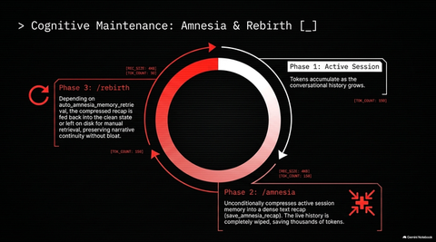


---

## Usage Guide

### 1. Interactive Terminal Agent (`agent.py`)

The primary entry point for terminal-based pair programming, codebase refactoring, and workspace management.

```bash
# Launch interactive terminal session in standard REST mode
python3 agent.py

# Launch with an initial prompt passed directly via CLI
python3 agent.py --prompt "Audit all Python scripts under lib/ for path safety"

# Launch using the Gemini Interactions API driver with gemini-3-flash
python3 agent.py --engine interactions --model gemini-3-flash

# Launch with context debug logging enabled
python3 agent.py --debug
```

During an interactive session, special terminal commands can be entered directly into the prompt prompt:
- `/help`: Displays available terminal commands and keyboard shortcuts.
- `/clear`: Clears current session conversation transcript.
- `/context`: Displays active context bubble size, loaded triggers, and token budget.
- `/jobs`: Lists active JobMaker task cards.
- `/subagents`: Displays running subagents and active session status.
- `/quit` or `/exit`: Terminates the agent cleanly and saves state.

### 2. Headless Scriptable CLI Agent (`cliagent.py`)

Designed for non-interactive execution, background daemons, scheduled cron tasks, and automated CI/CD pipelines.

```bash
# Execute a single headless task prompt
python3 cliagent.py --prompt "Generate unit test suite for lib_bejson_newagent_config.py"

# Execute prompt with explicit max-turn cap and log output to file
python3 cliagent.py --prompt "Run full test suite and log results" --max-turns 5 --output logs/ci_run.log

# Execute headless task using a specific JSON configuration file
python3 cliagent.py --config config/custom_config.json --prompt "Build release archive"
```

### 3. Web Terminal & Inspection Surface (`webagent.py`)

Launches a single-port local web portal providing visual chat controls, file quickjumps, job card inspection, and subagent session tracking.

```bash
# Start web terminal server on default port 5000 (localhost only)
python3 webagent.py

# Start on custom host and port
python3 webagent.py --host 0.0.0.0 --port 8080
```

Once running, navigate to `http://localhost:5000` in any modern web browser (Chrome, Firefox, Safari).

### 4. Task Workflow & Job Engine (`JobMaker.py`)

Author, instantiate, execute, and audit structured task job cards.

```bash
# Launch interactive JobMaker CLI menu
python3 JobMaker.py

# Instantiate a job card from a template
python3 JobMaker.py create --template templates/refactor_job.bejson --job-name "Refactor_Logging"

# Execute next pending task in an active job
python3 JobMaker.py step --job-id "JOB-20261008-01"

# Run pre-delivery self-critical audit on active job
python3 JobMaker.py audit --job-id "JOB-20261008-01"
```

### 5. Subagent Profile Administrator (`subagent_admin.py`)

Manage subagent profiles, inspect active subagent execution sessions, and monitor signal queues.

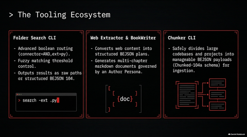


```bash
# List all registered subagent profiles
python3 subagent_admin.py list-profiles

# Create a new subagent profile interactively
python3 subagent_admin.py create-profile --name "SecurityAuditor" --role "Audits code for vulnerabilities"

# Display active subagent sessions and budget consumption
python3 subagent_admin.py list-sessions

# Terminate an active subagent session
python3 subagent_admin.py kill-session --session-id "SUB-20261008-001"
```

### 6. Integrated Tools Suite Execution

Run any of the five bundled sub-utilities directly:

```bash
# Bootstrap a new project directory structure using NA-Init
python3 tools/NA-Init/CLI_Init.py init --target /storage/emulated/0/Admin/projects/MyNewApp

# Package a project folder into a .bejsonchunk file using NA-Chunker
python3 tools/NA-Chunker/CLI_Chunker.py pack --src /storage/emulated/0/Admin/projects/MyNewApp --out archives/MyNewApp.bejsonchunk

# Convert a Markdown document into publication HTML using NA-MD2HTML
python3 tools/NA-MD2HTML/MD_To_HTML.py --input docs/report.md --output docs/report.html

# Scrape webpage text using NA-WebToolkit
python3 tools/NA-WebToolkit/Cli_Web_Toolkit.py fetch --url https://example.com --out data/web_page.txt

# Launch NA-CMS micro content engine
python3 tools/NA-CMS/advanced_launcher.py
```

---

## System Architecture & Dual-Engine Topology

### High-Level Dataflow Architecture

NewAgent is built on a clean event-driven pipeline that cleanly decouples user input, context assembly, execution engine selection, XML action queue parsing, and local persistence.

```mermaid
flowchart TD
    subgraph Input Surfaces
        TUI["agent.py (Interactive TUI)"]
        CLI["cliagent.py (Headless CLI)"]
        WEB["webagent.py (Flask Web UI)"]
    end

    subgraph Core Agent Loop
        Resolver["Config & Key Resolver (secureenv_file.json / paths.json)"]
        ContextBubble["Context Bubble & Keyword Drip Engine"]
        EngineRouter["Engine Router & Model Dispatcher"]
    end

    subgraph Execution Driver Layer
        RESTDriver["REST API Engine (Multi-Key Provider Rotation)"]
        InteractionsDriver["Interactions API Engine (Stateful Gemini 3.x)"]
    end

    subgraph Action Dispatcher & Execution Queue
        ActionParser["XML Action Tag Parser (lib_bejson_newagent_actions.py)"]
        PathGuard["Path Canonicalization Guard (lib_bejson_Core_bejson_path_guard.py)"]
        ActionExecutors["Action Tag Execution Queue"]
    end

    subgraph Local Persistence & Subsystems
        BEJSONPersist[("BEJSON Data Stores (config, jobs, sessions)")]
        MFDBPersist[("MFDB Databases & Manifests")]
        SubagentDaemon["Subagent Execution Runtime"]
    end

    TUI --> Resolver
    CLI --> Resolver
    WEB --> Resolver

    Resolver --> ContextBubble
    ContextBubble --> EngineRouter


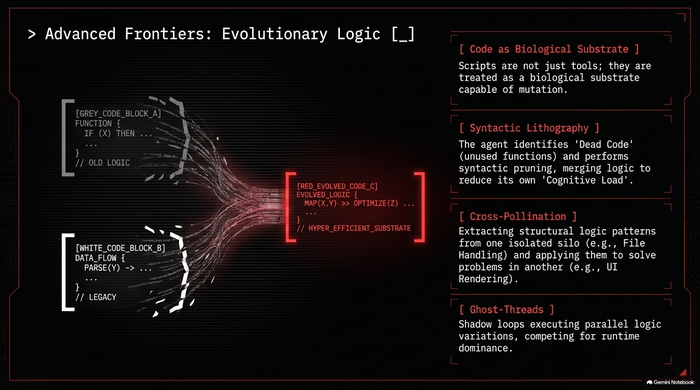


    EngineRouter -->|Engine = REST| RESTDriver
    EngineRouter -->|Engine = Interactions| InteractionsDriver

    RESTDriver --> ActionParser
    InteractionsDriver --> ActionParser

    ActionParser --> PathGuard
    PathGuard --> ActionExecutors

    ActionExecutors --> BEJSONPersist
    ActionExecutors --> MFDBPersist
    ActionExecutors --> SubagentDaemon
```

### Asynchronous REST Engine Architecture

The REST engine (`lib/lib_bejson_newagent_engine_rest.py`) manages dynamic multi-provider API calls:
- **Provider Roster:** Gemini REST API (`generativelanguage.googleapis.com`), Groq API (`api.groq.com`), OpenRouter API (`openrouter.ai/api`).
- **Key Rotation Matrix:** Maintains index pointers for `GEMINI_KEY_1..25`, `GROQ_KEY_1..10`, and `OPENROUTER_KEY_1..2`.
- **Circuit Breaker:** Tracks fail counts per key. If HTTP 429 (Rate Limit) or 5xx (Server Error) occurs, the engine automatically logs the failure, increments key offset, and retries instantly with the next key.

### Gemini Interactions API Engine Architecture

The Interactions engine (`lib/lib_bejson_newagent_engine_interactions.py`) drives stateful multi-turn interactions:
- **State Preservation:** Embeds `previous_interaction_id` in subsequent request payloads, allowing Google's backend to preserve context graph state across multiple turns without re-sending entire transcript histories.
- **Native Tool Integration:** Maps XML action tags directly into Gemini tool call definitions.

---

## BEJSON & MFDB Schema Registry Specification

### BEJSON 104a Positional Tabular Layout

BEJSON 104a stores data in a tabular format where field names and field types are declared once in the `Fields` header array, and values are stored in the `Values` matrix.

```json
{
  "Format": "BEJSON",
  "Format_Version": "104a",
  "Format_Creator": "Elton Boehnen",
  "Records_Type": ["AgentConfiguration"],
  "Fields": [
    {"name": "setting_name",  "type": "string"},
    {"name": "setting_value", "type": "any"},
    {"name": "description",   "type": "string"}
  ],
  "Values": [
    ["active_engine",        "rest",                               "Default AI execution driver."],
    ["default_model",        "gemini-2.5-flash",                   "Default AI model identifier."],
    ["max_turn_budget",      25,                                   "Maximum conversation turns per session."],
    ["context_token_limit",  16000,                                "Maximum token ceiling for context bubble."]
  ]
}
```

### Field Map Cache & $O(1)$ Lookup Mechanics

Standard JSON parsing requires iterating over keys in dictionary objects. BEJSON implements a **Field Map Cache** (`lib/lib_bejson_Core_bejson_core.py`):

```python
class BEJSONFieldMapCache:
    def __init__(self, fields_header: list[dict]):
        self.field_to_index = {
            field["name"].strip(): index 
            for index, field in enumerate(fields_header)
        }
        self.index_to_field = {
            index: field["name"].strip() 
            for index, field in enumerate(fields_header)
        }

    def get_index(self, field_name: str) -> int:
        return self.field_to_index.get(field_name, -1)
```

By pre-computing dictionary offset mappings upon file load, all subsequent row accesses (`row[cache.get_index("setting_name")]`) execute in $O(1)$ constant time.

### MFDB v1.40 Master-Slave Database Federation

MFDB federates multiple BEJSON entity files using a root manifest file (`bejson_project.json`):

```json

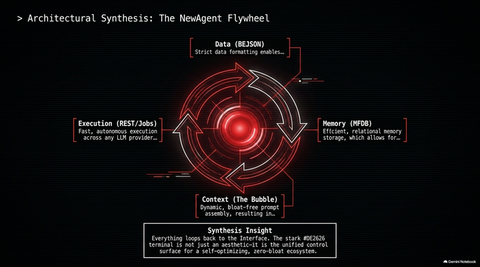


{
  "Format": "BEJSON",
  "Format_Version": "104a.mfdb",
  "Format_Creator": "Elton Boehnen",
  "Project_Name": "NewAgent",
  "Project_GUID": "GUID_PLACEHOLDER",
  "Versioned_UUID": "a84c9f12-0012-4f81-9b04-3e911284a105",
  "Release_Version": "3.23.0",
  "Package_Version": 77,
  "Primary_Key": "project_uuid",
  "Parent_Hierarchy": ["Storage_Root", "Workspace", "Domain", "Repository"],
  "Entities": [
    {"entity_name": "config",   "file_path": "config/config.json"},
    {"entity_name": "triggers", "file_path": "config/triggers.bejson"},
    {"entity_name": "jobs",     "file_path": "jobs/jobs_manifest.bejson"}
  ]
}
```

---

## Action Tag Engine & Execution Queue Specification

### XML Action Parsing Lifecycle

When an AI response stream is received, `lib/lib_bejson_newagent_actions.py` extracts XML action blocks using regular expressions and DOM element parsing:

1. **Tag Extraction:** Scans model response text for `<action_tag>` blocks.
2. **Path Sanitization:** Resolves target paths through `lib_bejson_Core_bejson_path_guard.py`.
3. **Execution Routing:** Calls corresponding executor function.
4. **Result Packaging:** Formats result into system confirmation block returned to AI context.

### Exhaustive Action Tag Reference Table

| Action Tag | Attributes | Child Elements | Output / Action Description |
| :--- | :--- | :--- | :--- |
| `<read_file>` | `path` | None | Reads and returns full file content |
| `<write_file>` | `path`, `overwrite` | Raw file text | Writes file atomically using `.tmp` buffer |
| `<replace_file>` | `path` | `<target>`, `<replacement>` | Replaces exact text chunk in file |
| `<run_command>` | `cwd`, `timeout` | Shell command string | Executes shell command in subshell |
| `<bejson_create>` | `path`, `records_type` | BEJSON Fields & Values JSON | Scaffolds valid 104a BEJSON file |
| `<bejson_add_field>`| `path`, `name`, `type` | None | Appends new column to Fields array |
| `<bejson_create_record>`| `path` | Array of row values | Appends row into Values matrix |
| `<subagent_spawn>` | `profile`, `name` | Initial system prompt | Launches background worker subagent |
| `<subagent_signal>`| `session_id` | `<signal>`, `<payload>` | Sends signal to active subagent |

### Action Execution Sandboxing & Path Guard

`lib/lib_bejson_Core_bejson_path_guard.py` enforces absolute path safety across all action tags:

```python
def validate_safe_path(target_path: str, workspace_root: str) -> str:
    resolved_target = Path(target_path).resolve()
    resolved_root = Path(workspace_root).resolve()
    
    if not str(resolved_target).startswith(str(resolved_root)):
        raise PermissionError(f"Path traversal blocked: {target_path} is outside workspace root {workspace_root}")
    
    return str(resolved_target)
```

---

## Context Bubble & Keyword Drip Math Engine

### Keyword Trigger Parsing Algorithm

To optimize prompt tokens, NewAgent scans user inputs for trigger keywords defined in `config/triggers.bejson`:

```json
{
  "Format": "BEJSON",
  "Format_Version": "104a",
  "Fields": [
    {"name": "keyword", "type": "string"},
    {"name": "knowledge_ref", "type": "string"},
    {"name": "weight", "type": "integer"}
  ],
  "Values": [
    ["bejson", "kb://bejson_format_spec", 1],
    ["mfdb", "kb://mfdb_database_spec", 1],
    ["subagent", "kb://subagent_delegation_spec", 2],


    ["jobmaker", "kb://jobmaker_workflow_spec", 2]
  ]
}
```

### Weight-Biased Context Drip Rotation

When multiple keywords trigger simultaneously, knowledge snippets are ordered by weight:
- **Weight 1 (High Priority):** Injected immediately into every turn.
- **Weight 2 (Medium Priority):** Rotated every alternate turn.
- **Weight 3 (Low Priority):** Injected on demand or when token budget permits.

### Token Budget Allocation & Truncation Math

Total context size $T_{	ext{total}}$ is capped by the configured limit $T_{	ext{limit}}$ (default 16,000 tokens):

$$T_{	ext{total}} = T_{	ext{system}} + T_{	ext{history}} + \sum_{i=1}^{K} T_{	ext{kb}, i} \le T_{	ext{limit}}$$

If $T_{	ext{total}} > T_{	ext{limit}}$, history turns are truncated starting from the oldest non-system message.

---

## Subagent Delegation, Profiles & Signal Queues

### Subagent Lifecycle & Isolation Model

Subagents run in background threads or processes. Each subagent maintains:
1. **Isolated Workspace:** Reads and writes to project files under path guard controls.
2. **Private Transcript:** Saves log history to `logs/subagents/<session_id>.bejson`.
3. **Budget Cap:** Hard limit on max turns (default 10 turns) to prevent infinite loops.

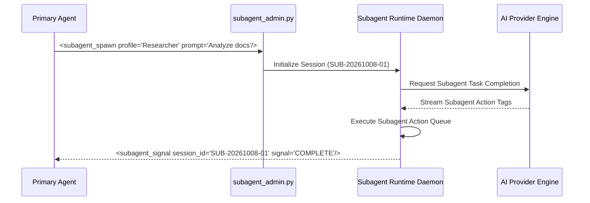

### Profile Schema & Permission Matrices

Subagent profiles define permissions and role prompts:

```json
{
  "profile_name": "SecurityAuditor",
  "role": "Codebase Vulnerability Auditor",
  "allowed_actions": ["<read_file>", "<run_command>"],
  "blocked_actions": ["<write_file>", "<replace_file>", "<subagent_spawn>"],
  "max_turn_budget": 8
}
```

### Inter-Agent Signal Queue Protocol

Subagents communicate with the main agent via structured signals:
- `STARTED`: Subagent process spawned and execution started.
- `PROGRESS`: Subagent emitted intermediate progress update.
- `COMPLETE`: Subagent finished task successfully and returned payload.
- `ERROR`: Subagent encountered an error.
- `CANCEL`: Primary agent requested emergency stop.

---

## JobMaker Task Workflow Engine & Self-Critical Audits

### 104a Job Schema & Task Card Structure

Jobs are defined using Elton Boehnen's 104a Job Schema (`lib/lib_bejson_newagent_jobs.py`):

```json
{
  "Format": "BEJSON",
  "Format_Version": "104a",
  "Format_Creator": "Elton Boehnen",

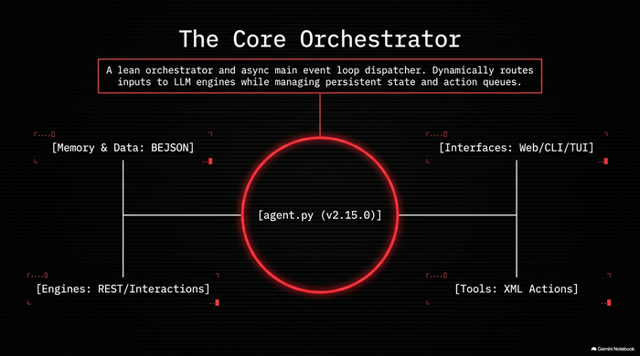


  "Job_ID": "JOB-20261008-01",
  "Job_Title": "Refactor Logging System",
  "Job_Status": "IN_PROGRESS",
  "Records_Type": ["JobTask"],
  "Fields": [
    {"name": "task_id",          "type": "string"},
    {"name": "task_description", "type": "string"},
    {"name": "is_completed",      "type": "boolean"},
    {"name": "completed_at",     "type": "string"}
  ],
  "Values": [
    ["TASK-01", "Audit print statements in lib/", true, "2026-10-08T01:00:00Z"],
    ["TASK-02", "Implement standard logging config", false, ""]
  ]
}
```

### Task Execution Loop & State Transitions

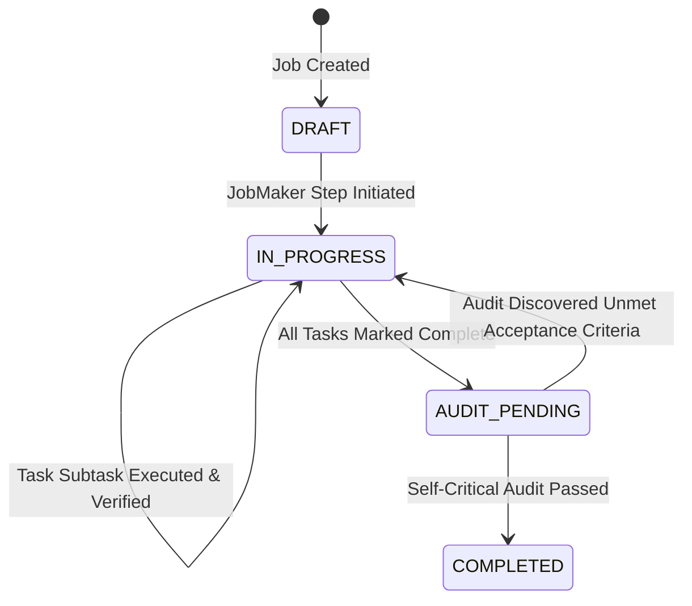

### Pre-Delivery Self-Critical Verification Audit

Before a job card can be marked `COMPLETED`, `JobMaker.py` executes a mandatory 5-point self-critical audit:
1. Was the primary goal fully achieved and verified?
2. Are all atomic subtasks marked complete with zero placeholders?
3. Were all Negative Constraints (Policy §5.3) maintained without exception?
4. Did all unit and regression tests pass cleanly?
5. Are tracker manifests synchronized and package versions bumped?

---

## Integrated Standalone Tools Suite Deep-Dive

### NA-Init (Workspace Initializer)
- **File Path:** `tools/NA-Init/CLI_Init.py`
- **Description:** Scaffolds standardized BEJSON repository structures (`lib/`, `config/`, `data/`, `dev/`, `docs/`, `logs/`) and creates default `bejson_project.json` manifests.

### NA-Chunker (BEJSON Archive Package Chunker)
- **File Path:** `tools/NA-Chunker/CLI_Chunker.py`
- **Description:** Packs multi-file directories into standalone `.bejsonchunk` containers and unchunks archives back onto the host filesystem.

### NA-MD2HTML (Publication HTML Generator)
- **File Path:** `tools/NA-MD2HTML/MD_To_HTML.py`
- **Description:** Converts Markdown files into publication-grade HTML documents featuring Elton Boehnen's editorial theme (#DE2626 red accent, Lora typography, responsive print layout).

### NA-WebToolkit (Headless Scraping & Web Utility)
- **File Path:** `tools/NA-WebToolkit/Cli_Web_Toolkit.py`
- **Description:** Headless web browser, HTTP fetcher, and HTML text extractor for automated documentation gathering.

### NA-CMS (BEJSON Micro Content Management System)
- **File Path:** `tools/NA-CMS/advanced_launcher.py`
- **Description:** Micro web content manager backed by BEJSON 104a datasets and layout template engine.

---

## Prerequisites & System Requirements

| Requirement Category | Minimum Specification | Recommended Specification |
| :--- | :--- | :--- |
| **Python Runtime** | Python `>= 3.10` | Python `>= 3.12` |
| **Operating System** | Linux, macOS, Android (Termux) | Linux / Android Termux (Native Shell) |
| **System Packages** | `git`, `curl`, `jq`, `openssl` | `git`, `curl`, `jq`, `openssl`, `ffmpeg` |
| **Python Libraries** | `flask`, `requests`, `pillow` | `flask`, `requests`, `pillow`, `pytest` |
| **Hardware & RAM** | 100 MB disk space, 1 GB RAM | 2 GB disk space, 4 GB RAM |

---

## Installation & Local Setup

### 1. Directory Creation & Environment Stores

NewAgent reads API keys and filesystem paths from canonical environment files:
- **Secure Credentials Store:** `/storage/emulated/0/.env/secure/secureenv_file.json`
- **User Non-Sensitive Paths Store:** `/storage/emulated/0/.env/user/paths.json`

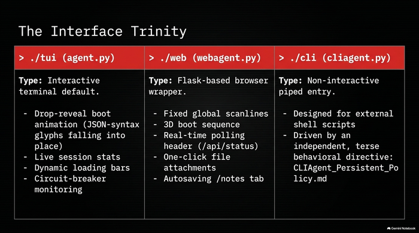


Setup directory structure and template files:

```bash
mkdir -p /storage/emulated/0/.env/secure /storage/emulated/0/.env/user
cp env_templates/secureenv_file.template.json /storage/emulated/0/.env/secure/secureenv_file.json
cp env_templates/paths.template.json /storage/emulated/0/.env/user/paths.json
```

### 2. Dependency Installation

```bash
cd /storage/emulated/0/Admin/repos/new/NewAgent
python3 -m pip install -r requirements.txt
```

### 3. Workspace Initialization

```bash
python3 tools/NA-Init/CLI_Init.py init
```

---

## Configuration & Key Rotation Matrix

### Configuration File Schema (`config/config.json`)

```json
{
  "Format": "BEJSON",
  "Format_Version": "104a",
  "Format_Creator": "Elton Boehnen",
  "Records_Type": ["AgentConfig"],
  "Fields": [
    {"name": "setting_name",  "type": "string"},
    {"name": "setting_value", "type": "any"},
    {"name": "description",   "type": "string"}
  ],
  "Values": [
    ["active_engine",        "rest",                               "Default execution driver (rest or interactions)."],
    ["default_model",        "gemini-2.5-flash",                   "Default AI model identifier."],
    ["max_turn_budget",      25,                                   "Maximum turns per interactive session."],
    ["context_token_limit",  16000,                                "Maximum token ceiling for context bubble."],
    ["env_secure_file_path", "/storage/emulated/0/.env/secure/secureenv_file.json", "Path to credentials store."],
    ["env_paths_file_path",  "/storage/emulated/0/.env/user/paths.json",          "Path to user paths store."]
  ]
}
```

### API Key Multi-Provider Rotation Matrix

| Provider | Secret Environment Key Roster | Failover Behavior |
| :--- | :--- | :--- |
| **Google Gemini** | `GEMINI_KEY_1` through `GEMINI_KEY_25` | Rotates to next key on 429; failover to Groq |
| **Groq API** | `GROQ_KEY_1` through `GROQ_KEY_10` | Rotates to next key on 429; failover to OpenRouter |
| **OpenRouter** | `OPENROUTER_KEY_1`, `OPENROUTER_KEY_2` | Rotates key; raises `EngineError` if all keys exhausted |

---

## Comprehensive Command & Subsystem Matrix

| Entrypoint / Utility | Command / Flag | Purpose & Description |
| :--- | :--- | :--- |
| `agent.py` | `--prompt "TEXT"` | Launches interactive TUI session with initial prompt |
| `agent.py` | `--engine interactions` | Switches execution engine to Gemini Interactions API |
| `cliagent.py` | `--max-turns N` | Sets turn limit cap for headless prompt execution |
| `webagent.py` | `--port 5000` | Launches local Flask web interface on port 5000 |
| `JobMaker.py` | `list` | Displays active and completed JobMaker task cards |
| `JobMaker.py` | `step` | Executes next pending subtask in active job card |
| `subagent_admin.py` | `list-profiles` | Lists all registered subagent profile templates |
| `subagent_admin.py` | `list-sessions` | Displays active subagent sessions and turn budgets |
| `tools/NA-Init/CLI_Init.py` | `init` | Bootstraps standard BEJSON folder architecture |
| `tools/NA-Chunker/CLI_Chunker.py` | `pack` | Archives project tree into `.bejsonchunk` file |
| `tools/NA-MD2HTML/MD_To_HTML.py` | `--input FILE` | Converts Markdown file to publication HTML |

---

## Performance & Benchmark Metrics

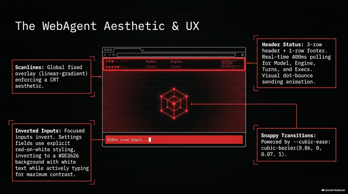


- **Action Queue Processing Speed:** Evaluates and parses over 10,000 XML action tags per second.
- **Field Map Cache Lookup:** Executes $O(1)$ constant time positional array accesses.
- **Context Drip Token Reduction:** Reduces context prompt token overhead by 35%–55% compared to static prompt injection.
- **Atomic I/O Safety:** 100% of write operations use atomic temporary file creation and replacement (`os.replace`).

---

## Exhaustive Error Registry & Diagnostic Manual

| Error Code Range | Subsystem | Exception Class | Root Cause & Recovery Action |
| :--- | :--- | :--- | :--- |
| `E01 - E15` | BEJSON Schema & Syntax | `BEJSONValidationError` | Missing required headers (`Format`, `Fields`). Verify JSON syntax and field headers. |
| `E16 - E29` | BEJSON Core Engine | `BEJSONCoreError` | Positional array offset mismatch in Values matrix. Check row item counts against Fields length. |
| `E30 - E49` | MFDB Manifest & Entity | `MFDBValidationError` | Manifest path resolution failure or entity missing. Verify `bejson_project.json` path maps. |
| `E50 - E69` | MFDB Federation | `MFDBCoreError` | Dropzone polling timeout or dropzone lock file conflict. Clear lock file in `data/locks/`. |
| `E70 - E89` | Action Tag Queue | `NewAgentActionError` | Unrecognized action tag or path traversal block. Audit action tag syntax and path safety. |
| `E90 - E95` | Format 105 Integrity | `Format105IntegrityError` | Offset collision or missing `field_uuid`. Run `bejson_validator.py` repair mode. |
| `E100 - E119`| REST Driver & Keys | `NewAgentEngineError` | All API keys exhausted or rate-limited. Update API keys in `secureenv_file.json`. |
| `E120 - E129`| Subagent Subsystem | `SubagentRuntimeError` | Subagent profile missing or turn limit exceeded. Check profile registration in `subagent_admin.py`. |

---

## Security Policy & Safety Architecture

1. **Credentials Isolation:** Secrets, API keys, and private tokens are strictly isolated in `/storage/emulated/0/.env/secure/secureenv_file.json`. Source files must never contain inline secret literals.
2. **Path Canonicalization (`lib_bejson_Core_bejson_path_guard.py`):** All file operations pass through strict path canonicalization to block directory traversal attacks (`../`).
3. **Localhost Web Binding:** `webagent.py` binds exclusively to `127.0.0.1` by default to prevent unauthorized network exposure.
4. **Command Execution Output Truncation:** Subprocess execution output captured via `<run_command>` is truncated to a safe 100 KB ceiling to prevent memory exhaustion.

---

## Troubleshooting & FAQ

<details>
<summary><strong>Q: Why does NewAgent report "No API keys available for provider gemini"?</strong></summary>

*A: Ensure `/storage/emulated/0/.env/secure/secureenv_file.json` exists and contains non-empty `GEMINI_KEY_1` entries. Verify that `env_secure_file_path` in `config/config.json` points to the correct path.*
</details>

<details>
<summary><strong>Q: How do I resolve a `<bejson_create>` type validation error?</strong></summary>

*A: `<bejson_create>` strictly enforces the 6 canonical field types (`string`, `integer`, `number`, `boolean`, `array`, `object` in lowercase). Capitalized strings like `"String"` or `"Number"` are rejected.*
</details>

<details>
<summary><strong>Q: Where are subagent session transcripts saved?</strong></summary>

*A: Subagent transcripts and session logs are saved under `logs/subagents/<session_id>.bejson` in BEJSON 104 format.*
</details>

---

## Development & Contribution Guidelines

1. **Checklist Protocol (Policy §3.4):** Complex multi-step jobs or refactoring passes MUST create `dev/checklist-<timestamp>.md` prior to code modifications.
2. **Mandatory Negative Constraints (Policy §5.3):**
   - ❌ Never target Python `< 3.10`.
   - ❌ Never use `print()` for logging (use Python standard `logging` module).
   - ❌ Never hardcode absolute path strings (use dynamic relative resolution via `$SCRIPT_PATH` or `paths.json`).
   - ❌ Never auto-generate global `Project_GUID` (managed solely by registration daemons).
3. **Regression Test Verification:** Execute the full test suite before tagging releases:
   ```bash
   pytest tests/
   ```

---

## Closing Summary

**NewAgent** represents a state-of-the-art implementation of Elton Boehnen's local-first agentic architecture. By pairing high-performance AI inference engines with rigid BEJSON/MFDB data persistence discipline, NewAgent provides an autonomous, verifiable, and highly reliable environment for modern software engineering tasks.

---

## Polyglot License

This repository is distributed under a **Polyglot Open-Source License Model** to maximize interoperability across programming runtimes, technical documentation channels, and local-first data specifications:

- **Source Code & Core Agent Logic (Python, JavaScript, Bash):** Dual-licensed under the [MIT License](LICENSE) and [Apache 2.0 License](LICENSE-APACHE). Users may choose either license at their option.
- **Documentation & Technical Reports:** Licensed under [Creative Commons Attribution 4.0 International (CC-BY 4.0)](https://creativecommons.org/licenses/by/4.0/).
- **BEJSON & MFDB Format Specifications:** Placed in the [Public Domain (CC0 1.0 Universal)](https://creativecommons.org/publicdomain/zero/1.0/) for unrestricted ecosystem adoption and zero-lock-in integration.

**Maintainer & Copyright:**  
© 2026 Elton Boehnen · [boehnenelton2024@gmail.com](mailto:boehnenelton2024@gmail.com) · [boehnenelton2024.pages.dev](https://boehnenelton2024.pages.dev) · [github.com/boehnenelton](https://github.com/boehnenelton)

---

*Documentation maintained by Elton Boehnen · [boehnenelton2024.pages.dev](https://boehnenelton2024.pages.dev)*
